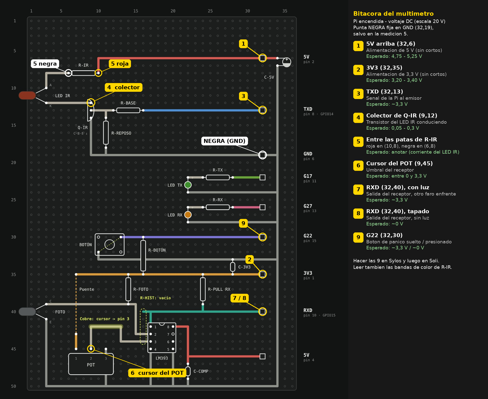

# Bitácora de pruebas con multímetro — Faros de FaroNet

**Proyecto 1 · Redes de Computadoras · TEC**

| Dato | Faro de Sylos | Faro de Soli |
|---|---|---|
| Fecha | 1 de noviembre de 2026, 20:40 | 1 de noviembre de 2026, 20:50 |
| Responsable | | |
| Multímetro (marca / modelo) | | |

## Condiciones

El enunciado pide una bitácora con **continuidad, ausencia de cortos entre VCC y GND antes de energizar, y voltajes
en puntos clave**. Las placas ya están soldadas, conectadas y en uso, y no se desconectan hasta la revisión, así que
todas las mediciones se hacen **con la Raspberry Pi encendida**, en **voltaje DC** (escala de 20 V):

- **Ausencia de cortos entre VCC y GND:** si hubiera un corto, la alimentación caería o la Pi se apagaría. Medir 5 V y
  3,3 V en su valor nominal con la placa funcionando lo descarta (mediciones 1 y 2).
- **Continuidad:** cada pin muestra el voltaje que le llega por su pista. Una pista abierta daría 0 V o un valor
  flotante (mediciones 3 a 9).
- **Voltajes en puntos clave:** emisor, receptor y botón (mediciones 3 a 9).

Seguridad: nunca usar Ω ni continuidad con la placa energizada; punta negra fija en GND; la punta roja toca un solo
punto a la vez (los pines de la columna 32 están a 2,54 mm y unir 5 V con un pin GPIO puede dañar la Pi).

Coordenadas **(columna, fila)** según el diagrama actual de la perfboard. Los 9 puntos están marcados sobre el diagrama
en [`BITACORA_puntos_de_medicion.png`](BITACORA_puntos_de_medicion.png). Punta negra siempre en **GND (32,19)**, salvo
en la medición 5.

## Mediciones

| # | Qué se mide | Dónde va la punta roja | Condición | Esperado | Qué demuestra | Sylos (V) | Soli (V) |
|---|---|---|---|---|---|---|---|
| 1 | **Alimentación de 5 V** (emisor IR y LM393) | Pin 5V de arriba **(32,6)** | reposo | 4,75 – 5,25 V | No hay corto entre 5 V y GND; la pista de 5 V llega | 4,94 ✅ | 5,04 ✅ |
| 2 | **Alimentación de 3,3 V** (botón, fototransistor y salida del receptor) | Pin 3V3 **(32,35)** | reposo | 3,20 – 3,40 V | No hay corto entre 3,3 V y GND; la pista de 3,3 V llega | 3,31 ✅ | 3,27 ✅ |
| 3 | **Señal de transmisión** que manda la Pi al emisor | Pin TXD **(32,13)** | reposo | ≈ 3,3 V | La pista TXD llega; en reposo el UART queda en alto (LED IR encendido) | 3,23 ✅ | 3,23 ✅ (ver obs.) |
| 4 | **Transistor del emisor** conduciendo | **Colector de Q-IR (9,12)**: la pata del 2N3904 conectada al cátodo (K) del LED IR (orden C·B·E de arriba abajo) | reposo (LED IR encendido) | 0,05 – 0,3 V | El transistor está saturado y deja pasar la corriente del LED IR | 0,026 ✅ | 0,030 ✅ |
| 5 | **Caída en la resistencia del LED IR** (para calcular su corriente) | **Entre las dos patas de R-IR**: punta roja en **(10,8)**, lado de 5 V; punta negra (sale de GND) en **(6,8)**, lado del LED | reposo (LED IR encendido) | anotar | Corriente del LED IR = V / R-IR | 1,80 | 1,90 |
| 6 | **Umbral del receptor** | **Cursor del POT (9,45)**: la pata del medio, que va a la pata 3 del LM393 | reposo | entre 0 y 3,3 V | El divisor del potenciómetro llega al comparador | 0,70 ✅ | 1,00 ✅ |
| 7 | **Salida del receptor, con luz** | Pin RXD **(32,40)** | el otro faro enfrente, a ~15 cm | ≈ 3,3 V (alto) | El receptor detecta la luz y la pista RXD llega a la Pi | 3,30 ✅ | 3,31 ✅ |
| 8 | **Salida del receptor, sin luz** | Pin RXD **(32,40)** | fototransistor tapado con una tarjeta | ≈ 0 V (bajo) | El comparador cambia de estado | 0,040 ✅ | 0,040 ✅ |
| 9 | **Botón de pánico** | Pin G22 **(32,30)** | botón suelto / presionado | ≈ 3,3 V / ≈ 0 V | El pull-up y el botón funcionan; la pista G22 llega | 3,30 / 0,000 ✅ | 3,31 / 0,000 ✅ |

**Resistencias** (por código de colores; iguales en las dos placas, numeración de
[`RESISTENCIAS_numeradas.png`](RESISTENCIAS_numeradas.png)):

| # | Referencia | Valor |
|---|---|---|
| 1 | R-IR | **2 × 220 Ω en serie = 440 Ω** (no había una resistencia del valor necesario) |
| 2 | R-BASE | 1 kΩ |
| 3 | R-REPOSO | 10 kΩ |
| 4 | R-TX | 1 kΩ |
| 5 | R-RX | 1 kΩ |
| 6 | R-BOTÓN | 10 kΩ |
| 7 | R-FOTO | 10 kΩ |
| 8 | R-PULL RX | 10 kΩ |

**Corriente del LED IR.** La medición 5 se tomó sobre una de las dos resistencias de 220 Ω. Se comprueba con la ley
de voltajes de Kirchhoff: 5 V − 2 × V(R) − V(colector) deja en el LED un voltaje típico de un LED infrarrojo.

| | Sylos | Soli |
|---|---|---|
| V en una resistencia de 220 Ω (medición 5) | 1,80 V | 1,90 V |
| Corriente del LED IR = V / 220 Ω | **8,2 mA** | **8,6 mA** |
| V en el LED IR = 5 V (med. 1) − 2 × med. 5 − colector (med. 4) | 4,94 − 3,60 − 0,026 = **1,31 V** | 5,04 − 3,80 − 0,030 = **1,21 V** |

Las dos corrientes son seguras para el LED (máximo típico de 50 – 100 mA) y su voltaje queda en el rango normal de un
LED infrarrojo (1,1 – 1,5 V).

## Observaciones

| Fecha | Faro | Observación |
|---|---|---|
| 01/11/2026 | Sylos | Medición 4: 26 mV en el colector, por debajo del rango orientativo (0,05 – 0,3 V): el transistor está en saturación profunda, que es lo deseado. Medición 1: 4,94 V con la placa funcionando; la Pi reporta haber tenido bajo voltaje en algún momento (`throttled=0x50000`), pero en esta medición la alimentación está dentro del rango. |
| 01/11/2026 | Soli | Medición 3: se anotó "0,23"; se registra como 3,23 V porque la Pi reporta el pin TXD en alto (`pinctrl get 14` → `hi`) y las mediciones 4 y 5 muestran el LED IR encendido, lo que solo ocurre con TXD en alto. Medición 4: 30 mV, saturación profunda (igual que en Sylos). |
