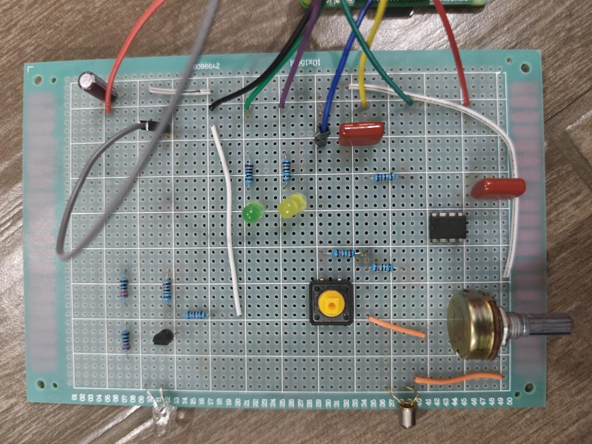
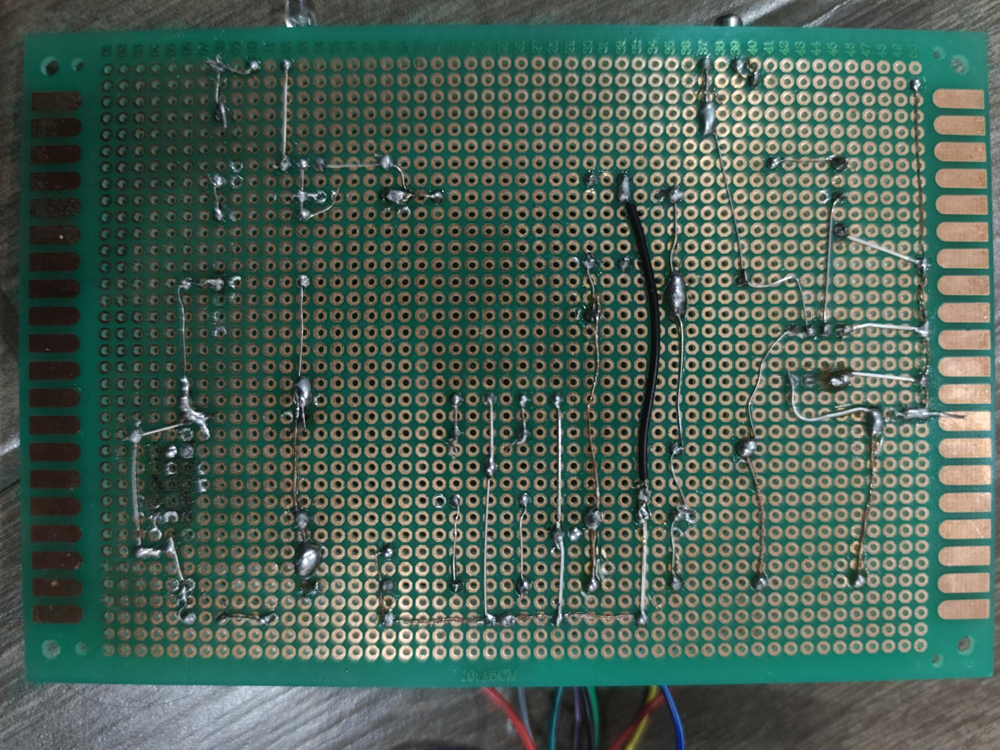
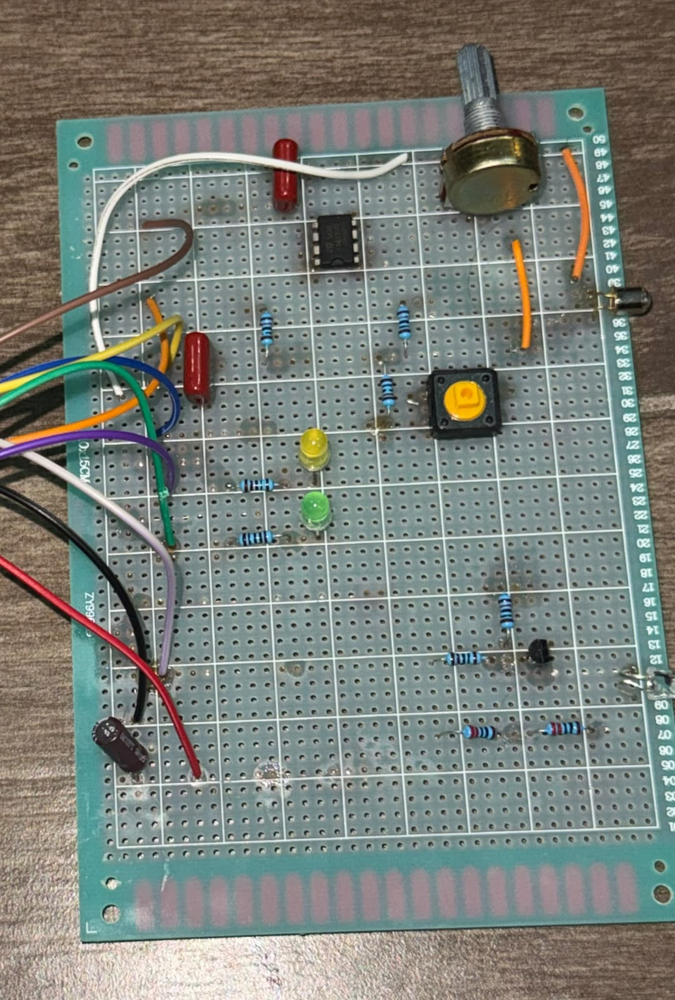
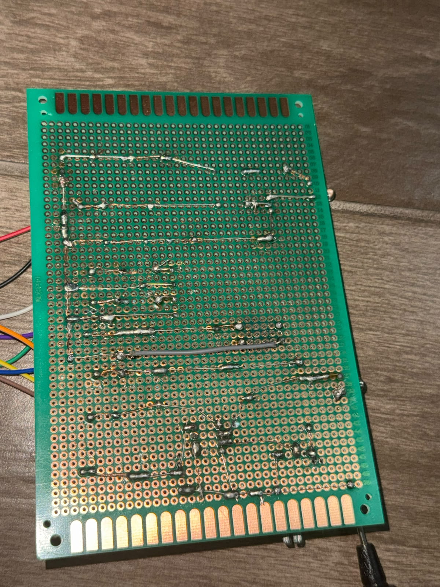
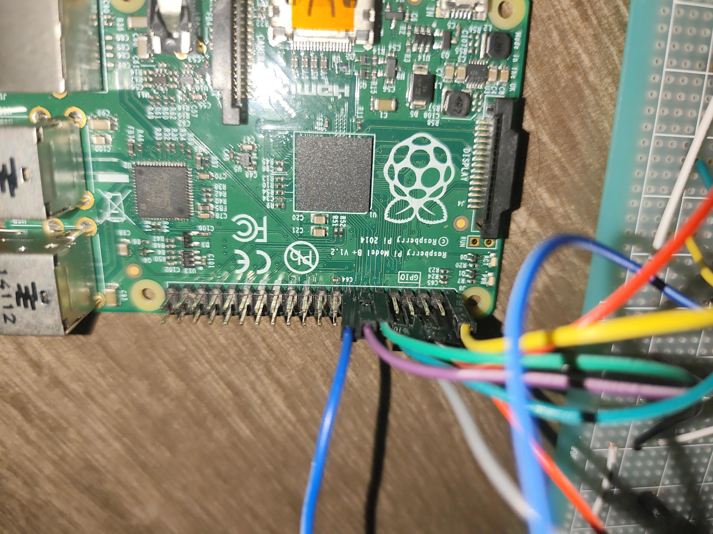
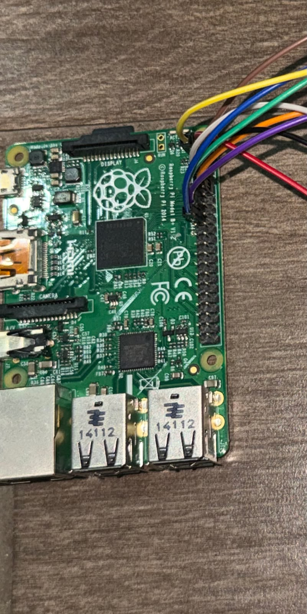

# FaroNet — Documentación técnica y bitácora de pruebas

**Proyecto 1 · Redes de Computadoras · TEC · Prof. Kevin Moraga**
Repositorio: <https://github.com/Josh-SolisF/Fasolis> · rama `cloudfare_try` · commit `b1bf882`
Fecha de las pruebas: domingo 1 de noviembre de 2026, 11:20 – 19:50 (hora de Costa Rica, UTC−6).
Segunda sesión del enlace óptico (16:24 – 17:35), después de ajustar los potenciómetros de los dos receptores.

> Este documento reúne lo que se probó **de forma remota y sin intervención humana**: software, enlace
> óptico (en la posición en que quedaron los faros), mesh con cebolla, gateway y Worker de Cloudflare,
> y el comportamiento de las Raspberry Pi. Lo que requiere manos (multímetro, mover los faros, presionar
> el botón, fotos) está en la sección **10. Pendientes físicos**, con instrucciones.

---

## Índice

1. [Resumen de resultados](#1-resumen-de-resultados)
2. [Arquitectura y equipo de prueba](#2-arquitectura-y-equipo-de-prueba)
3. [Hardware: el Faro](#3-hardware-el-faro) (incluye la lista de materiales, §3.4)
4. [Código: estructura y piezas clave](#4-código-estructura-y-piezas-clave)
5. [Pruebas automáticas](#5-pruebas-automáticas)
6. [Capa 1: enlace óptico (100, 65, 30, 15 y 7,5 cm)](#6-capa-1-enlace-óptico-100-65-30-15-y-75-cm)
7. [Capas 2 y 3: mesh y cebolla](#7-capas-2-y-3-mesh-y-cebolla)
8. [Capa 7: gateway y Worker de Cloudflare](#8-capa-7-gateway-y-worker-de-cloudflare)
9. [Comportamiento de las Raspberry Pi](#9-comportamiento-de-las-raspberry-pi)
10. [Pendientes físicos e incidencias](#10-pendientes-físicos-e-incidencias)
11. [Cómo reproducir las pruebas](#11-cómo-reproducir-las-pruebas)
12. [Trazabilidad con el enunciado](#12-trazabilidad-con-el-enunciado)

---

## 1. Resumen de resultados

| Área | Resultado | Detalle |
|---|---|---|
| Pruebas unitarias Python (84) | ✅ 84/84 en **ambas** Pi | Sylos 33,3 s · Soli 29,2 s |
| Pruebas del Worker (38) | ✅ 38/38 | 7 grupos: relay, salas/feed, buzón, directorio, rate limit, no registro, HTML |
| **Enlace óptico a 100 cm, tras ajustar los POT** | ✅ **los dos sentidos, BER = 0 hasta 1800 baudios** | 5000 bytes por sentido a 1800 sin errores (BER < 7,5 × 10⁻⁵ al 95 %); §6.6 |
| **Enlace óptico a 65 cm** | ✅ **los dos sentidos hasta 2700 baudios, ~1590 bit/s con ACK** | BER 0 en 40 000 bits por sentido; se bajó la sensibilidad de ambos receptores; §6.7 |
| **Enlace óptico a 7,5 cm** | ✅ **los dos sentidos hasta 3000 baudios, ~1762 bit/s con ACK** | BER 0 en 40 000 bits por sentido; 3600 bd con errores intermitentes; §6.10 |
| **Enlace óptico a 15 cm** | ✅ **los dos sentidos hasta 3600 baudios, ~2105 bit/s con ACK** | BER 0 en 40 000 bits por sentido; 4200 bd inestable en Soli → Sylos; §6.9 |
| **Enlace óptico a 30 cm** | ✅ **los dos sentidos hasta 3600 baudios, ~2105 bit/s con ACK** | BER 0 en 40 000 bits por sentido; tras bajar la sensibilidad; §6.8 |
| **Tasa efectiva con protocolo completo (ACK), 100 cm** | ✅ **1065 bit/s a 1800 baudios**, en los dos sentidos | 59 % de la velocidad del enlace, 0 retransmisiones; 2400 bd no es confiable; §6.6 |
| Primera sesión del enlace (antes del ajuste) | ⚠️ solo Sylos → Soli; se degradó en la tarde | §6.1 – §6.5 |
| Tasa efectiva sin ACK (difusión), 1200 bd | ✅ 2300 B / 20 tramas, SHA-256 idéntico | ≈ 864 bit/s de carga útil (72 % de 1200) |
| Mesh 6 nodos entre las 2 Pi (Wi-Fi) | ✅ | Rutas hasta 5 saltos, directorio con 6 firmas válidas |
| Cebolla: anónimo / firmado / respuesta / rotación de llaves | ✅ | 3 relays; latencia anónima ≈ 0,31 s |
| **Autoprueba (LEDs y botón) y botón de pánico real** | ✅ en los dos faros | Borra las llaves, rota la dirección física y lo indica con los LEDs; §3.3 |
| Faro como nodo de la mesh (solo luz, 1800 bd) | ✅ | PA y PB vecinos por luz; directo, anónimo, firmado y respuesta cruzan la luz; 0 paquetes fallidos; §7.6.1 |
| Rotación de dirección física | ✅ | `566B → 5A6F` y `5A6F → B840`; el otro faro la aprende por luz, sin perder paquetes |
| Worker en producción `faronet.fasolis.workers.dev` | ✅ | CSP, 401, rate limit 120/min, buzón, feed, directorio |
| Mesh → cebolla → gateway → Worker | ✅ **publicado en la sala** con la llave autorizada | ~1 s de punta a punta por Wi-Fi; directorio replicado (6 fichas); replay → 409; §8.6.1 |
| Sin IPs en registros | ✅ | 0 IPs en los logs de todos los nodos (dos rondas) |
| **Bug encontrado y corregido** | ✅ `buzon.py` recibía 403 de Cloudflare | Faltaba el encabezado `User-Agent`; corregido y probado contra el Worker real; §8.4 |
| **Alimentación de Sylos** | ⚠️ `throttled=0x50000` | Hubo bajo voltaje y throttling |

---

## 2. Arquitectura y equipo de prueba

### 2.1 Arquitectura (según el enunciado)

```
[Nodo PC] --USB-- [Faro A] ~~~ luz ~~~ [Faro B] --USB-- [Gateway RPi]
   |                                                        |
   +-------- mesh anónima (Ethernet / WiFi / Faro) ---------+
                                                            | HTTPS (firmado Ed25519)
                                                            v
                                                   [Edge: Cloudflare Workers]
                                                            |
                                                 clearnet (salas, feeds, buzón, directorio)
```

### 2.2 Equipo

| | **Sylos** | **Soli** |
|---|---|---|
| Placa | Raspberry Pi Model B+ Rev 1.2 (ARMv6, 1 núcleo, 700 MHz) | Raspberry Pi Model B+ Rev 1.2 |
| RAM | 426 MiB | 426 MiB |
| Sistema | Raspbian GNU/Linux 13 (trixie), kernel 6.18.50+rpt-rpi-v6 | igual |
| Python | 3.13.5 | 3.13.5 |
| Librerías | pynacl 1.5.0 · pyserial 3.5 · gpiozero | igual |
| Puerto del Faro | `/dev/serial0 → ttyAMA0` (PL011) | igual |
| Dirección física inicial | `566B` (rotada a `5A6F` en la prueba §7.5) | `2877` |
| Red | Wi-Fi 192.168.40.0/24 | Wi-Fi 192.168.40.0/24 |

> El hostname interno de ambas sigue siendo `raspberrypi`; en este documento se les llama Sylos y Soli.

### 2.3 Cómo se ejecutaron las pruebas

Desde la laptop corre un *puente* (`puente/puente.ps1`, fuera del repositorio por `.gitignore`) que toma
cada comando de un archivo, lo ejecuta por SSH en la Pi indicada y guarda la salida. Todo quedó
registrado con hora en `puente/log.txt`, que es la **evidencia cruda** de este documento.

---

## 3. Hardware: el Faro

### 3.1 Componentes y conexión a la Pi

Diagrama de la perfboard: `Prototipo Perfboard.jpeg` (pistas de cobre por debajo, componentes por encima,
pines Dupont en la columna 32). Esquema de protoboard en Fritzing: `Circuito Protoboard.jpeg`.

| Bloque | Componentes | Pin de la perfboard (col, fila) | Pin físico de la Pi |
|---|---|---|---|
| Alimentación | C-5V (desacople 5 V) | 5V (32,6) y (32,45) | 2 o 4 |
| | C-3V3 (desacople 3,3 V) | 3V3 (32,35) | 1 o 17 |
| | Riel GND | GND (32,19) | 6 |
| Emisor | LED IR + R-IR, transistor Q-IR (NPN) + R-BASE + R-REPOSO | TXD (32,13) | 8 (GPIO14) |
| Receptor | Fototransistor FOTO + R-FOTO, comparador LM393 + POT (umbral) + C-COMP, R-PULL RX | RXD (32,40) | 10 (GPIO15) |
| Indicador TX | LED verde + R-TX | G17 (32,22) | 11 (GPIO17) |
| Indicador RX | LED amarillo + R-RX | G27 (32,26) | 13 (GPIO27) |
| Botón de pánico | pulsador + R-BOTÓN (pull-up externo) | G22 (32,30) | 15 (GPIO22) |

### 3.2 Codificación de línea

El Faro usa el **UART de la Pi (8N1)** como modulador: cada bit en alto enciende el LED IR (vía Q-IR) y cada
bit en bajo lo apaga. Es **OOK con codificación NRZ**: 1 bit de inicio, 8 de datos y 1 de parada, 10 bits por byte.

Consecuencia observada: **en reposo el LED IR queda encendido**. Se verificó con `pinctrl`, que muestra
`14: a0 | hi`: la función es ALT0 (TXD0) y el nivel está en alto. Esto es esperable, porque un UART en reposo marca "1", y conviene explicarlo en el RFC.

### 3.3 Autoprueba del circuito

```bash
python3 -m faronet.faro.hardware   # enciende cada LED, hace la señal de pánico y espera el botón (no borra nada)
```
Resultado (19:31 – 19:33), con el equipo observando las placas:

| Paso | Sylos | Soli |
|---|---|---|
| 1/4 LED verde (TX) encendido 2 s | ✅ | ✅ |
| 2/4 LED amarillo (RX) encendido 2 s | ✅ | ✅ |
| 3/4 Señal de pánico (los dos LEDs parpadean 10 veces y quedan encendidos 1 s) | ✅ | ✅ |
| 4/4 Botón: en reposo se lee "suelto" | ✅ | ✅ |
| Pulsaciones del botón detectadas (cada una repite la señal de pánico) | ✅ 4 de 4 | ✅ 4 de 4 |

### 3.3.1 Botón de pánico real (19:33 – 19:36)

Se arrancó `faro_nodo` con un archivo de llaves de prueba (`--llaves /tmp/fn/PANICO.llaves`, para no tocar las
llaves reales) y el equipo presionó el botón una vez:

```
[PANICO] LEDs y boton de panico listos
[PANICO] Faro en /dev/serial0 a 1800 baudios, direccion B840, ~4.2 s por paquete
[PANICO] BOTON DE PANICO: borrando estado sensible...
[PANICO] llaves borradas: 1 archivo(s); nueva direccion fisica 13DA
```

| Verificación | Sylos | Soli |
|---|---|---|
| El nodo se detiene al presionar el botón | ✅ | ✅ |
| Archivo de llaves sobrescrito con ceros y borrado (ya no existe) | ✅ | ✅ |
| Llaves de cifrado en memoria olvidadas (`identidad.olvidar()`) | ✅ (el proceso termina) | ✅ |
| Dirección física rotada y guardada en `~/.faronet_direccion` | ✅ `B840 → 13DA` | ✅ `2877 → 879C` |
| Señal de pánico en los LEDs | ✅ vista por el equipo | ✅ vista por el equipo |

#### 3.3.2 Botón de pánico en el Faro gateway (19:45 – 19:50)

En la primera prueba, el pánico borraba solo las llaves del nodo; la llave del gateway (`~/.faronet/gateway.llave`,
la única credencial ante Cloudflare) quedaba en la Pi. Para cumplir "borrar las llaves y cualquier estado sensible",
se modificó `faronet/herramientas/faro_nodo.py` (sin commit todavía): si existe la llave del gateway, el pánico
primero **detiene `gateway_nodo`** (que la tiene en memoria) y luego **la borra** junto con las demás.

Prueba en Soli con `gateway_nodo` corriendo y la llave real instalada (las 84 pruebas automáticas pasan con el cambio):

```
[PANICO] BOTON DE PANICO: borrando estado sensible...
[PANICO] llave del gateway: se borra (gateway_nodo detenido)
[PANICO] llaves borradas: 2 archivo(s); nueva direccion fisica B2C6
```

| Verificación | Resultado |
|---|---|
| `gateway_nodo` corriendo antes / después | 2 procesos → **0** |
| `~/.faronet/gateway.llave` | **borrada** |
| Llaves del nodo | borradas |
| Dirección física de Soli | `879C → B2C6` |

**Recuperación** (la llave original sigue en la laptop; no hay que tocar Cloudflare):

```powershell
.\scripts\reinstalar_llave_gateway.ps1            # copia la llave a Soli y muestra la llave pública
```
Los comandos, listos para copiar y pegar, están en `RECUPERAR_LLAVE_GATEWAY.txt` (raíz del repositorio).

Después se vuelve a arrancar `gateway_nodo`. Probado: la llave reinstalada da `91678aa4…ec24` (igual a
`GATEWAY_PUBKEY`) y `gateway --probar` respondió **HTTP 204**. Si la llave pudo haber sido copiada por alguien, en
lugar de reinstalarla hay que generar una nueva, poner su llave pública en `GATEWAY_PUBKEY` (`edge/wrangler.jsonc`)
y redesplegar con `npx wrangler deploy`.

**Para la revisión:** conviene demostrar el botón de pánico en **Sylos**, que no es el gateway. Si se demuestra en
Soli, se corre el script de arriba y en un minuto el gateway vuelve a publicar.

### 3.4 Lista de materiales (BOM)

Fuentes: la lista de compras del Faro (9 de octubre de 2026), cruzada con el diagrama de la perfboard, y las
**facturas de compra** (9 y 12 de octubre de 2026). **Por Faro** es lo que lleva cada placa; **Total** es lo que se
consiguió para los dos Faros, incluidos los repuestos. Los precios son los de las facturas, en colones: el precio
unitario es **sin IVA** y el IVA (13 %) se suma al final de cada factura.

#### Componentes del circuito

| # | Componente | Especificación (descripción en la factura) | Referencia en la placa | Por Faro | Total | Precio unit. sin IVA (₡) | Subtotal sin IVA (₡) |
|---:|---|---|---|---:|---:|---:|---:|
| 1 | LED infrarrojo | 5 mm, 940 nm ("LEDS INFRAROJO", DL-592) | LED IR | 1 | 4 | 266,00 | 1 064,00 |
| 2 | Fototransistor infrarrojo | 5 mm, 2 patas ("SENSOR TRANSMISOR", ET-5) | FOTO | 1 | 3 | 1 168,14 | 3 504,42 |
| 3 | Base (socket) | DIP-8 ("BASE IC 8 PINES", BASE-8) | base del LM393 | 1 | 2 | 133,00 | 266,00 |
| 4 | Transistor NPN | 2N3904 | Q-IR | 1 | 3 | 353,98 | 1 061,94 |
| 5 | LED indicador RX | amarillo ("LED AMARILLO", DL-504) | LED RX | 1 | 3 | 97,35 | 292,05 |
| 6 | Condensador electrolítico | 47 µF, 35 V ("FILTRO 47X35") | C-5V | 1 | 1 | 97,35 | 97,35 |
| 7 | Comparador | LM393, DIP-8 | LM393 | 1 | 3 | sin factura | — |
| 8 | Trimmer (potenciómetro de ajuste) | 10 kΩ | POT (umbral del comparador) | 1 | 3 | sin factura | — |
| 9 | Condensador cerámico | 100 nF ("104") | C-3V3, C-COMP | 2 | 4 | sin factura | — |
| 10 | Condensador electrolítico (otra unidad) | 47 – 470 µF, ≥ 10 V (la lista pedía 100 µF, 16 V) | C-5V | — | 1 | sin factura | — |
| 11 | Resistencia | 10 kΩ, ¼ W | R-REPOSO, R-BOTÓN, R-FOTO, R-PULL RX | 4 | 8 | kit | — |
| 12 | Resistencia | 1 kΩ, ¼ W | R-BASE, R-TX, R-RX | 3 | 6 | kit | — |
| 12b | Resistencia | 220 Ω, ¼ W | R-IR (dos en serie = 440 Ω) | 2 | 4 | kit | — |
| 13 | LED indicador TX | verde | LED TX | 1 | 2 | kit | — |
| 14 | Pulsador con tapa | — | BOTÓN (pánico) | 1 | 2 (el kit trae 4) | kit | — |

**Nota sobre las resistencias.** Valores leídos por código de colores, iguales en las dos placas (numeración en
`RESISTENCIAS_numeradas.png`). **R-IR son dos resistencias de 220 Ω en serie (440 Ω)**, porque no había una del valor
necesario. Con ellas el LED infrarrojo trabaja a unos **8 mA** (8,2 mA en Sylos y 8,6 mA en Soli, calculados en
`BITACORA_MULTIMETRO.md`).

**Nota sobre el LED RX.** La factura confirma que se compraron LED **amarillos**, como dicen `hardware.py` y el
diagrama de la perfboard (la lista de compras decía "LED rojo").

**Nota sobre el electrolítico.** El "FILTRO 47X35" de la factura del 12 de octubre es el condensador electrolítico de
desacople de 5 V (C-5V): 47 µF, 35 V, dentro del rango aceptado como sustituto del de 100 µF (47 – 470 µF, 10 V o más).

#### Montaje, cableado y equipo

| # | Material | Especificación (descripción en la factura) | Uso | Total | Precio unit. sin IVA (₡) | Subtotal sin IVA (₡) |
|---:|---|---|---|---:|---:|---:|
| 15 | Placa perforada | "PLACA BAQUELITA", HS-03 | base del circuito soldado | 2 | 1 769,91 | 3 539,82 |
| 16 | Cables Dupont macho–hembra | paquete de 40 ("JUMPERS PARA PROTOBOARD MACHO HEMBRA TMC 40PCS") | conexión perfboard ↔ Pi | 1 paquete | 4 000,00 | 4 000,00 |
| 17 | Cables Dupont macho–macho | paquete de 20 ("JUMPER MACHO MACHO PARA PROTOBOARD TMC 20PCS") | prototipo en protoboard | 1 paquete | 3 628,30 | 3 628,30 |
| 18 | Tarjeta microSD | 32 GB, clase 10 (ADATA AUSDH32GUICL10A1-RA1) | sistema operativo de cada Pi | 2 | 3 982,30 | 7 964,60 |
| 19 | Tira de pines macho | 40 pines, 2,54 mm (9 por placa) | conector de la perfboard | 1 tira | kit | — |
| 20 | Alambre sólido aislado | 22 AWG | puentes por encima de la placa | 5 m | sin factura | — |
| 21 | Termoencogible negro | ~5 mm | tubo para bloquear la luz ambiente en el fototransistor | 20 cm | sin factura | — |
| 22 | Soldadura | 60/40, 0,8 mm | soldadura | 3 m | sin factura | — |
| 23 | Raspberry Pi | Model B+ Rev 1.2 | nodo de cada Faro | 2 | préstamo del Laimii | — |
| 24 | Fuente de alimentación | microUSB, 5 V / 2,5 A | alimentación de cada Pi | 2 | sin factura | — |

> Sylos reportó bajo voltaje (`throttled=0x50000`, §9.1). Conviene revisar que su fuente sea efectivamente
> de 2,5 A y que el cable microUSB sea corto y de buen calibre.

#### Costo total (según las facturas)

| Factura | Comercio | Fecha | Artículos | Subtotal sin IVA (₡) | IVA 13 % (₡) | Total (₡) |
|---|---|---|---|---:|---:|---:|
| Ticket 00100001040000080435 | Electrónica CR | 09/10/2026 | LED IR, sensores, bases DIP-8, 2N3904, placas | 9 436,18 | 1 226,70 | 10 662,88 |
| Ticket 00100001040000080474 | Electrónica CR | 12/10/2026 | condensador 47 µF / 35 V, LED amarillos | 389,40 | 50,62 | 440,02 |
| Factura 00300001040000036498 | Electrónica MJ (Inversiones Elizondo Quirós) | 12/10/2026 | jumpers macho–hembra y macho–macho | 7 628,32 | 991,68 | 8 620,00 |
| Factura 08900001040000042473 | Extreme Technology (Extremetech) | 09/10/2026 | 2 microSD 32 GB | 7 964,60 | 1 035,40 | 9 000,00 |
| **Total** | | | | **25 418,50** | **3 304,40** | **28 722,90** |

**Costo total de los dos Faros: ₡28 722,90** (unos ₡14 361 por Faro). No incluye las piezas del kit de Arduino, las
Raspberry Pi (préstamo del Laimii) ni las piezas sin factura (LM393, trimmers, condensadores cerámicos, alambre,
termoencogible, soldadura y fuentes).

#### Herramientas y material de prototipo (no forman parte del Faro)

| Herramienta | Especificación | Origen |
|---|---|---|
| Cautín | 30 W, punta fina | compra o préstamo |
| Soporte para cautín | con esponja | compra o préstamo |
| Pelacables / cortador | de electrónica | compra o préstamo |
| Multímetro digital | voltaje DC, resistencia y continuidad | compra o préstamo |
| Protoboard | 830 puntos + mini (prototipo) | kit |
| Cables macho–macho | 30 unidades (prototipo) | kit |
| Potenciómetro 10 kΩ | ajuste del umbral durante las pruebas en protoboard | kit |
| Sensor "Flame" | primer fototransistor para las pruebas | kit |

#### Sustitutos aceptados (según la lista de compras)

| Pieza | Sustituto |
|---|---|
| LED IR 940 nm | LED IR de 850 nm o de 3 mm |
| LM393 (DIP-8) | LM339 (DIP-14, con base DIP-14) |
| 2N3904 | 2N2222, PN2222, BC547 o BC337 (en los BC el orden de las patas es distinto) |
| Fototransistor | TCRT5000 suelto (reemplaza LED IR + fototransistor) o fotodiodo IR con resistencia de 100 kΩ |
| Trimmer 10 kΩ | cualquier valor entre 5 kΩ y 100 kΩ |
| Electrolítico 100 µF | de 47 µF a 470 µF, 10 V o más |
| Resistencia 10 kΩ | entre 8,2 kΩ y 12 kΩ |

Piezas del kit que **no** sirven aunque se parezcan: el "IR Receiver" de 3 patas, los "CDS" (son LDR),
los LEDs azules y los "Cap ×4" (son puentes de plástico). Tampoco sirven el LM358 ni el LM741 en lugar del LM393.

### 3.5 Fotos de los Faros soldados

| Faro | Cara de componentes | Cara de soldadura |
|---|---|---|
| Soli | [](fotos/Soli_cara_superior.jpg) | [](fotos/Soli_cara_inferior.jpg) |
| Sylos | [](fotos/Sylos_cara_superior.jpg) | [](fotos/Sylos_cara_inferior.jpg) |

**Conexión a los pines de la Pi** (referencia para volver a conectar en la revisión; ver la tabla de §3.1):

| Faro | Foto |
|---|---|
| Soli | [](fotos/Soli_conexion_pines.jpg) |
| Sylos | [](fotos/Sylos_conexion_pines.jpg) |

---

## 4. Código: estructura y piezas clave

### 4.1 Estructura

| Carpeta / archivo | Líneas | Función |
|---|---:|---|
| `faronet/faro/capa1.py` | 385 | Trama, CRC, decodificador y `DispositivoLuzAdaptador` (maestro/esclavo con ACK) |
| `faronet/faro/enlace_faro.py` | 305 | El Faro como un vecino más de la mesh (hilo, cola, difusión → ACK) |
| `faronet/faro/hardware.py` | 254 | LEDs TX/RX, botón de pánico, borrado seguro |
| `faronet/mesh/paquete.py` | 72 | Paquete de 512 bytes de tamaño fijo |
| `faronet/mesh/nodo.py` | 632 | Nodo: vecinos TCP, vector de distancias, terminal |
| `faronet/mesh/cebolla.py` | 466 | Enrutamiento por capas (tipo Sphinx simplificado) |
| `faronet/mesh/identidad.py` | 170 | Llaves de firma y de cifrado (rotables) y fichas |
| `faronet/mesh/directorio.py` | 210 | Directorio de fichas firmadas |
| `faronet/herramientas/*.py` | 9 programas | `enviar`, `recibir`, `medir_enlace`, `faro_nodo`, `gateway`, `gateway_nodo`, `buzon` |
| `edge/src/*.ts` | 883 | Worker: `index`, `auth`, `control`, `sala`, `feed`, `buzon`, `directorio` |
| `pruebas/*.py` | 84 pruebas | Capa 1 (18), cebolla (48), gateway/buzón (10), scripts (8) |
| `edge/pruebas/edge.test.ts` | 38 pruebas | Worker con entorno falso |

### 4.2 Trama de Capa 1 (`capa1.py`)

```
 Sincronía(2)=AA 55 | Versión(1) | Tipo(1) | Destino(2) | Origen(2) |
 Secuencia(1) | Fragmento(1) | Longitud(1) | Datos(0..115) | CRC-16(2)
```
- Tamaño máximo: 2 + 9 + 115 + 2 = **128 bytes** (límite del enunciado). Un ACK mide 13 bytes.
- Tipos: `1` datos · `2` ACK · `3` trama externa (creada fuera del Faro; el Faro solo la transporta).
- Destino `FFFF` = difusión (sin ACK). Fragmento: bit 7 = "vienen más", bits 0–6 = índice.
- CRC-16/CCITT (`binascii.crc_hqx`, valor inicial 0) desde Versión hasta Datos.

```python
def codificar(t: Trama) -> bytes:
    """Trama -> bytes listos para escribir en el puerto serie."""
    if len(t.datos) > MAX_DATOS:
        raise ValueError(f"datos de {len(t.datos)} bytes; el maximo es {MAX_DATOS}")
    cuerpo = struct.pack(
        _FORMATO_ENCABEZADO,
        VERSION, t.tipo, t.destino, t.origen, t.secuencia, t.fragmento, len(t.datos),
    ) + bytes(t.datos)
    crc = binascii.crc_hqx(cuerpo, 0)
    return SINCRONIA + cuerpo + struct.pack(">H", crc)
```

**Acceso al medio:** semidúplex maestro/esclavo. El maestro envía cada fragmento y espera su ACK, con reintentos. Al
transmitir descarta su propio eco (`guarda_eco`), y el esclavo espera `retardo_ack` antes de contestar.
Los tiempos se escalan con la velocidad:

```python
t_byte = 10 / baudios                              # 8N1
guarda_eco   = max(0.01, 4 * t_byte)
retardo_ack  = 2 * guarda_eco
timeout_byte = max(0.5, 30 * t_byte)               # el driver entrega bytes en grupos
```

**Dirección física:** 2 bytes aleatorios (evita `0000` y `FFFF`), guardados en `~/.faronet_direccion`
(memoria no volátil). Rotarla es reescribir el archivo (`direccion_persistente(rotar=True)`).

### 4.3 Paquete de la mesh (`paquete.py`)

```
   0        1        2                 6        8                     512
   +--------+--------+-----------------+--------+---------------------+
   |Versión |  Tipo  |   Id circuito   |Longitud| Contenido + relleno |
   +--------+--------+-----------------+--------+---------------------+
```
Todos los paquetes miden **512 bytes**. El relleno es aleatorio y sirve para minimizar los metadatos.
Tipos: `1` HOLA · `2` DATOS · `3` RUTAS · `4` CEBOLLA · `5` MENSAJE · `10–14` directorio.
El paquete de datos lleva destino pero **no origen**.

### 4.4 Cebolla (`cebolla.py`)

- El cliente elige **3 relays** del directorio y envuelve el mensaje en una capa por relay.
- La llave de cada capa sale de un DH X25519 efímero con la llave de cifrado del relay. El flujo
  XSalsa20 (keystream de SecretBox) conserva el tamaño, así que la celda mide lo mismo en todo el camino.
- **MAC por salto** (BLAKE2b con llave, 8 bytes) sobre todo el bloque. Si un relay altera un bit, el siguiente lo detecta.
- **Relleno determinista** tipo Sphinx (*filler*), para que no haya bytes que un relay pueda cambiar sin ser detectado.
- Mensaje final: **SealedBox** hacia el destinatario (extremo a extremo), en tres variantes:
  `anónimo` (sin remitente), `firmado` (remitente autenticado con Box, visible solo para el destinatario)
  y `público` (tema + texto, sellado hacia el gateway).
- Anti-repetición: cada relay recuerda las llaves efímeras ya vistas.
- Solo se usa PyNaCl; **no hay primitivas criptográficas propias**.

```
Celda: Versión(1) | Efímera(32) | MAC(8) | Bloque(R)
Cabecera de cada salto: Siguiente(16) | EfímeraSig(32) | MACsig(8)
```

Limitaciones conocidas, documentadas en el propio código:
- El secreto hacia adelante es parcial: depende de la rotación de llaves.
- Los MAC son de 64 bits.
- No hay mezcla ni retardos, así que un observador global puede correlacionar por tiempos.

### 4.5 Firma del gateway (`gateway.py` ↔ `edge/src/auth.ts`)

```python
def firmar(llave: SigningKey, metodo: str, ruta: str, ts: int, cuerpo: bytes) -> str:
    """Debe coincidir con verificarGateway() de edge/src/auth.ts."""
    mensaje = f"{metodo}\n{ruta}\n{ts}\n{hashlib.sha256(cuerpo).hexdigest()}".encode()
    return llave.sign(mensaje).signature.hex()
```
Encabezados `X-Faro-Ts` y `X-Faro-Firma`. El Worker acepta una ventana de 60 s y rechaza con 409 una firma ya vista.

### 4.6 Worker (`edge/`)

| Ruta | Quién | Qué |
|---|---|---|
| `POST /gateway/publicar` | gateway (firmado) | publica en la sala de un tema |
| `POST /gateway/directorio` | gateway (firmado) | réplica del directorio (cada ficha se re-verifica) |
| `GET /`, `/sala/:tema` | navegador | páginas con CSP + nonce |
| `GET /sala/:tema/ws` | navegador | WebSocket en vivo (Durable Object por tema) |
| `GET /sala/:tema/historial`, `/feed.atom` | cualquiera | JSON y feed Atom |
| `GET /directorio[/:nombre]` | cualquiera | réplica de solo lectura |
| `PUT/GET /buzon/:id` | cualquiera | buzón muerto: blob de 1024 B, se borra al leer, TTL 24 h |

---

## 5. Pruebas automáticas

### 5.1 Python en el hardware real (84 pruebas)

```bash
cd ~/Fasolis && python3 -m unittest discover -v
```

| Pi | Resultado | Tiempo |
|---|---|---|
| Sylos | **Ran 84 tests … OK** | 27,3 s de prueba (33,3 s reales) |
| Soli | **Ran 84 tests … OK** | 29,2 s |

Cobertura: Capa 1 (codificar/decodificar, CRC, fragmentos, ACK, duplicados), cebolla (recorrido por 3
relays, relay equivocado, celda alterada, repetición, rotación de llaves, tamaños fijos, versión
desconocida), gateway y buzón (firma por ruta, blobs de tamaño fijo, secreto equivocado) y scripts
(difusión sin ACK, archivo grande, trama externa en hexadecimal).

### 5.2 Worker (38 pruebas)

```
ok 1 - relay del gateway          (8)   ok 5 - limite de peticiones     (3)
ok 2 - salas y feed               (6)   ok 6 - politica de no registro  (2)
ok 3 - buzon muerto               (6)   ok 7 - paginas HTML             (3)
ok 4 - directorio publico        (10)
# tests 38 · suites 7 · pass 38 · fail 0
```
*Nota: se ejecutaron con Node 22 (`--experimental-transform-types`) en lugar de `tsx`, que no se pudo
instalar en el entorno de prueba. El código probado es el de `edge/src/` sin modificar.*

---

## 6. Capa 1: enlace óptico (100, 65, 30, 15 y 7,5 cm)

Condiciones: faros a **100 cm**, frente a frente, luz ambiente normal de la tarde, interior.
Herramienta: `medir_enlace.py`.
- **Fase BER:** N bytes pseudoaleatorios sin trama. El receptor cuenta los bits distintos y cada byte perdido cuenta como 8 bits errados.
- **Fase de tasa:** el mismo volumen con el protocolo completo (tramas, CRC, ACK y reintentos).

### 6.1 Verificación inicial del medio (11:52)

En reposo, el TXD de las dos Pi está en `hi` (LED IR encendido). El RXD de Sylos estaba en `hi` y el de Soli en `lo`.
Con bytes crudos a 1200 bd no llegaba nada en ninguna dirección, por la alineación de ese momento. Los faros se reacomodaron después.

### 6.2 BER Sylos → Soli (primera sesión, 100 cm, 15:09 – 15:18)

| Baudios | Bytes | Bits recibidos con error | BER | Cota superior 95 % si BER=0 |
|---:|---:|---:|---|---|
| 1200 | 1000 | 0 | **0** | < 3,8 × 10⁻⁴ |
| 1200 | 2000 | 0 | **0** | < 1,9 × 10⁻⁴ |
| 2400 | 2000 | 0 | **0** | < 1,9 × 10⁻⁴ |
| 2400 | 5000 | 0 | **0** | < 7,5 × 10⁻⁵ |
| 3000 | 5000 | 0 | **0** | < 7,5 × 10⁻⁵ |
| 3600 | 5000 | — | no llegó la marca de inicio | — |
| 4800 | 2000 | 74 | **4,62 × 10⁻³** | — |
| 9600 | 2000 | — | no llegó la marca de inicio | — |

La cota se calcula con la regla del 3: con 0 errores en *n* bits, BER < 3/*n* al 95 %.

**Velocidad máxima confiable en ese momento: 3000 baudios** (con 5000 bytes y 0 errores). A partir de
3600 bd el comparador ya no sigue los flancos del fototransistor.

Ejemplo de salida (receptor):
```
[1/2] Esperando BER crudo (1000 bytes, hasta 60 s)...
      Recibidos 1000/1000 bytes, 0 bits errados, BER = 0.00e+00
RESULTADO;receptor;1200;100cm;1000;BER=0.00e+00;mensaje=fallo
```
`mensaje=fallo` corresponde a la fase de tasa con ACK, que no puede completarse (§6.3).

### 6.3 Sentido Soli → Sylos y tasa con ACK

| Prueba | Resultado |
|---|---|
| Bytes crudos `00 55 AA FF` a 300 y 1200 bd (15:10) | **0 bytes** recibidos en Sylos |
| Nivel del RXD de Sylos durante la transmisión | **178/178 muestras en bajo**: no percibe luz |
| Repetición (15:44) | 0 bytes, 178/178 en bajo |
| `medir_enlace` con fase de tasa | `SIN CONFIRMACION tras 6.4 s · Tramas enviadas: 3` |

Sin el sentido de regreso no llegan los ACK, así que **no se puede medir la tasa efectiva con
protocolo completo**. La causa es física: alineación, umbral del POT de Sylos o potencia del IR de
Soli. Ver §10.

### 6.4 Tasa efectiva en un solo sentido (difusión, sin ACK)

Archivo aleatorio de 2300 bytes enviado a `FFFF`. Se fragmenta en 20 tramas de hasta 115 B y el receptor lo reensambla.

| Baudios | Resultado | Tiempo | Carga útil |
|---:|---|---|---|
| 1200 | ✅ 2300/2300 B, **SHA-256 idéntico** (`09487572…ab7992`) | 21,3 s de luz (24,0 s con arranque del programa) | **≈ 864 bit/s (72 %)** · 766 bit/s de punta a punta |
| 2400 | ❌ el mensaje no se completó (falta al menos una trama) | 12,9 s | — |

El 72 % corresponde al encabezado de cada trama (13 B por cada 115 B de datos) más los 2 bits de inicio y parada por byte.

### 6.5 Estabilidad en el tiempo

| Hora | 1200 bd | 2400 bd | Observación |
|---|---|---|---|
| 15:09–15:18 | BER 0 | BER 0 | ventana buena |
| 15:19–15:23 | — | sin marca | se degrada; 4800 y 3600 también fallan |
| 15:22 | bytes crudos correctos | — | |
| 15:24 | — | bytes corrompidos (`00 00 C8…`) | |
| 15:26 | difusión 2300 B ✅ | difusión ❌ | |
| 15:44–15:48 | 3/3 sin marca; bytes `00 FE` en lugar de `00 55 AA FF` | — | también falla 1200 |

Los pulsos de "luz apagada" llegan **estirados**: los bits en 1 se leen como 0. Hipótesis, en orden de
probabilidad:
1. La luz ambiente fue cambiando durante la tarde y movió el punto de operación del comparador, con un umbral (POT) cerca del límite.
2. Sylos, el emisor, tuvo **bajo voltaje** (`throttled=0x50000`, §9): menos corriente en el LED IR.
3. A 100 cm el margen es pequeño y el fototransistor responde lento a la poca luz.

**Recomendación para la medición oficial:** ajustar el POT con el monitor de RXD, cubrir el receptor con un
tubo (por ejemplo, termoencogible negro) para bloquear la luz ambiente, usar una fuente de 5 V / 2,5 A en Sylos y
medir a 10, 50 y 100 cm en la misma sesión.

### 6.6 Segunda sesión: después de ajustar los potenciómetros (16:24 – 17:22)

**Qué se ajustó.** Los dos receptores tenían el umbral del comparador demasiado cerca del nivel de "luz": la luz
débil del otro faro a 1 m no siempre lo cruzaba, y los momentos de luz apagada llegaban estirados (se enviaba
`00 55 AA FF` y se recibía `00 00 00 FE`). Se subió la sensibilidad:

1. **Soli**: con eso, Sylos → Soli pasó de fallar a 1800 a dar BER 0 a 1800 y a 2400.
2. **Sylos**: se subió hasta el límite en que empieza a ver **su propio LED infrarrojo**. Pasado ese punto, la
   distorsión se invierte (llega `80 FF` en lugar de `00 55 AA FF`) y hasta 1800 falla; se devolvió a la mitad.

Entre mediciones se cerraron todos los procesos que usaban el puerto serie y los `watch` de monitoreo; un
receptor olvidado en segundo plano produjo un falso fallo (`multiple access on port`).

**BER (bytes crudos, sin protocolo), 100 cm:**

| Baudios | Sylos → Soli | Soli → Sylos |
|---:|---|---|
| 1200 | ✅ 0 / 8000 bits | ✅ 0 / 8000 bits |
| 1500 | ✅ 0 / 8000 bits | ✅ 0 / 8000 bits |
| 1800 | ✅ **0 / 40 000 bits** (BER < 7,5 × 10⁻⁵) | ✅ **0 / 40 000 bits** (BER < 7,5 × 10⁻⁵) |
| 2400 | ✅ 0 / 16 000 bits | ⚠️ 74 / 16 000 bits (**BER 4,6 × 10⁻³**) |

**Transferencia completa** (1000 bytes, 9 tramas con CRC, ACK por trama y reintentos):

| Baudios | Sentido | Tiempo | Tasa efectiva | Retransmisiones | Resultado |
|---:|---|---:|---:|---:|---|
| 1200 | Sylos → Soli | 11,23 s | **712 bit/s** | 0 | ✅ contenido correcto |
| 1200 | Soli → Sylos | 11,23 s | **712 bit/s** | 0 | ✅ contenido correcto |
| 1500 | Sylos → Soli | 9,01 s | **888 bit/s** | 0 | ✅ contenido correcto |
| 1500 | Soli → Sylos | 9,00 s | **889 bit/s** | 0 | ✅ contenido correcto |
| 1800 | Sylos → Soli | 7,51 s | **1065 bit/s** | 0 | ✅ contenido correcto (2 de 2 intentos; el otro dio 1053 bit/s) |
| 1800 | Soli → Sylos | 7,51 s | **1065 bit/s** | 0 | ✅ contenido correcto (2 de 2 intentos; el otro dio 1058 bit/s) |
| 2400 | Sylos → Soli | — | — | — | ❌ los datos llegan con BER 0, pero se pierden ACK de Soli → Sylos |

**Resultado: a 100 cm, la velocidad máxima confiable es 1800 baudios, con 1065 bit/s de carga útil en los dos
sentidos.** La eficiencia es de 59 %: cada trama de 115 bytes de datos lleva 13 bytes de encabezado y CRC, cada
byte ocupa 10 bits en el aire, y cada trama espera su ACK de 13 bytes más las pausas de eco.

Con el CRC, una trama de 128 bytes (1024 bits) con BER 4,6 × 10⁻³ llega dañada casi siempre, y un ACK de 13 bytes
falla en 4 de cada 10 intentos; por eso 2400 no funciona aunque el sentido Sylos → Soli sea perfecto.

**Para pasar de 1800:** el límite ahora es el receptor de Sylos, que no puede ser más sensible sin ver su propio LED.
Aislar ópticamente su fototransistor (tubo termoencogible negro y una separación opaca entre el LED IR y el FOTO de
la misma placa) permitiría subirle la sensibilidad; cambiar la fuente de Sylos (sigue con `throttled=0x50000`)
daría más potencia a su emisor.

### 6.7 Medición a 65 cm (17:44 – 18:08)

Condiciones: faros a **65 cm**, frente a frente, interior, luz ambiente normal (ya de noche).

> Nota: esta medición se registró primero como 25 cm por un error de unidades (la distancia estaba en pulgadas);
> la distancia real es **65 cm**.

**Calibración.** Con la sensibilidad que se dejó para 100 cm, a 65 cm llega unas 2,4 veces más luz y los dos receptores
se saturaban: se enviaba `00 55 AA FF` y llegaba `80 FF` (los momentos de luz apagada casi desaparecen).

| Prueba previa (sin reajustar) | Resultado |
|---|---|
| Sylos → Soli, 1200 bd | ✅ `00 55 AA FF` |
| Sylos → Soli, 1800 bd | ❌ `80 FF` (exceso de luz en Soli) |
| Soli → Sylos, 1200 bd | ❌ `80 FF` (exceso de luz en Sylos) |

Se **bajó la sensibilidad (POT) de los dos receptores**, con el mismo criterio de dejar el umbral a la mitad entre
el voltaje con luz y el voltaje tapado. Después del ajuste, los bytes crudos llegaron intactos en los dos sentidos
a 1200 y 1800 baudios.

**Transferencia completa** (1000 bytes, 9 tramas con CRC, ACK por trama y reintentos):

| Baudios | Sentido | Tiempo | Tasa efectiva | Retransmisiones | BER de la fase cruda | Resultado |
|---:|---|---:|---:|---:|---|---|
| 1200 | Sylos → Soli | 11,23 s | 712 bit/s | 0 | 0 / 8000 | ✅ |
| 1800 | Sylos → Soli | 7,52 s | 1063 bit/s | 0 | 0 / 8000 | ✅ |
| 1800 | Soli → Sylos | 7,52 s | 1064 bit/s | 0 | 0 / 8000 | ✅ |
| 2400 | Sylos → Soli | 5,65 s | **1415 bit/s** | 0 | 0 / 8000 | ✅ |
| 2400 | Soli → Sylos | 5,66 s | **1413 bit/s** | 0 | 0 / 8000 | ✅ |
| 2700 | Sylos → Soli | 5,03 – 5,04 s | **1588 – 1592 bit/s** | 0 | 0 / 8000 | ✅ 2 de 2 intentos |
| 2700 | Soli → Sylos | 5,03 – 5,04 s | **1587 – 1590 bit/s** | 0 | 0 / 8000 | ✅ 2 de 2 intentos |
| 3000 | Sylos → Soli | — | — | — | 3 / 8000 (**3,75 × 10⁻⁴**) | ❌ se pierden tramas |
| 3000 | Soli → Sylos | — | — | — | no llegó la marca de inicio | ❌ |

**BER con muestra grande a 2700 baudios:** 5000 / 5000 bytes y **0 errores en cada sentido** (40 000 bits; BER < 7,5 × 10⁻⁵ al 95 %).

**Resultado: a 65 cm, la velocidad máxima confiable es 2700 baudios, con unos 1590 bit/s de carga útil en los dos
sentidos**, un 49 % más que a 100 cm (1065 bit/s a 1800 bd). La eficiencia se mantiene en 59 % a todas las
velocidades, porque depende solo del formato de trama y del ACK.

**Lección para las demás distancias:** el umbral del receptor hay que **recalibrarlo en cada distancia**. Con poca luz
(lejos) los momentos de luz se pierden (`00 FE`); con mucha luz (cerca) el fototransistor se satura y los de
oscuridad se pierden (`80 FF`). El diagnóstico con bytes crudos dice hacia dónde mover el POT.

### 6.8 Medición a 30 cm (18:15 – 18:39)

Condiciones: faros a **30 cm**, frente a frente, interior, de noche.

> Nota: esta medición se registró primero como 10 cm por un error de unidades (la distancia estaba en pulgadas);
> la distancia real es **30 cm**.

**Primer intento, sin recalibrar (18:15 – 18:22).** Con la sensibilidad de 65 cm, a 30 cm llega unas 4,7 veces más
luz y el receptor de Soli se saturaba: a 2700 bd se enviaba `00 55 AA FF` y llegaba `80 FF`. Solo funcionaba
1200 bd (712 bit/s en los dos sentidos); desde 1800 bd la transferencia fallaba.

**Recalibración.** Se **bajó la sensibilidad** de los receptores con el mismo criterio de las otras distancias.
Después del ajuste, los bytes crudos llegaron intactos a 1800 y 2700 bd en los dos sentidos.

**Transferencia completa tras recalibrar** (1000 bytes, 9 tramas con CRC, ACK por trama y reintentos):

| Baudios | Sentido | Tiempo | Tasa efectiva | Retransmisiones | BER de la fase cruda | Resultado |
|---:|---|---:|---:|---:|---|---|
| 2700 | Sylos → Soli | 5,03 s | 1589 bit/s | 0 | 0 / 8000 | ✅ |
| 2700 | Soli → Sylos | 5,03 s | 1590 bit/s | 0 | 0 / 8000 | ✅ |
| 3000 | Sylos → Soli | 4,55 s | 1760 bit/s | 0 | 0 / 8000 | ✅ |
| 3000 | Soli → Sylos | 4,54 s | 1763 bit/s | 0 | 0 / 8000 | ✅ |
| 3600 | Sylos → Soli | 3,80 s | **2103 bit/s** | 0 | 0 / 8000 | ✅ |
| 3600 | Soli → Sylos | 3,80 s | **2105 bit/s** | 0 | 0 / 8000 | ✅ |
| 4200 | Sylos → Soli | — | — | — | 98 / 8000 (**1,23 × 10⁻²**) | ❌ |
| 4200 | Soli → Sylos | — | — | — | 0 / 8000 | ❌ los ACK van por el sentido con errores |
| 4800 | Sylos → Soli | — | — | — | no llegó la marca de inicio | ❌ |
| 4800 | Soli → Sylos | — | — | — | 0 / 8000 | ❌ los ACK van por el sentido con errores |

**BER con muestra grande a 3600 baudios:** 5000 / 5000 bytes y **0 errores en cada sentido** (40 000 bits; BER < 7,5 × 10⁻⁵ al 95 %).

**Resultado: a 30 cm, la velocidad máxima confiable es 3600 baudios, con unos 2105 bit/s de carga útil en los dos
sentidos** (58 % de la velocidad del enlace). Arriba de 3600, el sentido Sylos → Soli empieza a acumular errores;
Soli → Sylos todavía llega limpio a 4800, así que el límite lo pone el receptor de Soli o el emisor de Sylos.

### 6.9 Medición a 15 cm (18:43 – 18:53)

Faros a **15 cm**, frente a frente, interior, de noche, **sin tocar los POT**
(calibración de 30 cm): a esta distancia los bytes crudos llegaron intactos a 1200 y 3600 bd en los dos sentidos,
así que no hizo falta recalibrar.

**Transferencia completa** (1000 bytes, 9 tramas con CRC, ACK por trama y reintentos):

| Baudios | Sentido | Tiempo | Tasa efectiva | Retransmisiones | BER de la fase cruda | Resultado |
|---:|---|---:|---:|---:|---|---|
| 3600 | Sylos → Soli | 3,80 s | **2104 bit/s** | 0 | 0 / 8000 | ✅ |
| 3600 | Soli → Sylos | 3,80 s | **2107 bit/s** | 0 | 0 / 8000 | ✅ |
| 4200 | Sylos → Soli | 3,27 s | 2445 bit/s | 0 | 0 / 8000 | ✅ |
| 4200 | Soli → Sylos | 5,77 s / 3,27 s | 1386 / 2443 bit/s | 2 / 0 | 0 / 8000 | ⚠️ pasó, pero inestable |
| 4800 | Sylos → Soli | — | — | — | 0 / 8000 | ❌ los ACK van por el sentido con errores |
| 4800 | Soli → Sylos | — | — | — | no llegó la marca de inicio | ❌ |

**BER con muestra grande (5000 bytes = 40 000 bits por sentido):**

| Baudios | Sylos → Soli | Soli → Sylos |
|---:|---|---|
| 3600 | ✅ 0 errores (BER < 7,5 × 10⁻⁵) | ✅ 0 errores (BER < 7,5 × 10⁻⁵) |
| 4200 | ✅ 0 errores | ❌ 1000 bits errados (**BER 2,5 × 10⁻²**, en ráfaga) |

**Resultado: a 15 cm, la velocidad máxima confiable es 3600 baudios, con unos 2105 bit/s de carga útil en los dos
sentidos**, igual que a 30 cm. A 4200 bd el sentido Sylos → Soli funciona perfecto (2445 bit/s), pero Soli → Sylos
alterna transferencias limpias con ráfagas de errores, así que no se considera confiable.

Que 15 cm y 30 cm den el mismo máximo indica que, de cerca, el límite ya no es la cantidad de luz sino la
**velocidad de respuesta del fototransistor y del comparador** (el tiempo que tardan en cambiar de estado).

### 6.10 Medición a 7,5 cm (19:01 – 19:11)

Faros a **7,5 cm**, frente a frente, interior, de noche, **sin tocar los POT** (calibración de 30 cm).

**Transferencia completa** (1000 bytes, 9 tramas con CRC, ACK por trama y reintentos):

| Baudios | Sentido | Tiempo | Tasa efectiva | Retransmisiones | BER de la fase cruda | Resultado |
|---:|---|---:|---:|---:|---|---|
| 3000 | Sylos → Soli | 4,54 s | **1762 bit/s** | 0 | 0 / 8000 | ✅ |
| 3000 | Soli → Sylos | 4,54 s | **1762 bit/s** | 0 | 0 / 8000 | ✅ |
| 3600 | Sylos → Soli | 3,80 s (dos veces) | 2106 bit/s | 0 | 0 / 8000 | ✅ pero inestable (ver BER) |
| 3600 | Soli → Sylos | 3,79 s | 2109 bit/s | 0 | 216 / 8000 (**2,7 × 10⁻²**) | ⚠️ pasó, con errores en la fase cruda |
| 4200 | Sylos → Soli | — | — | — | — | ❌ |
| 4200 | Soli → Sylos | — | — | — | — | ❌ |

**BER con muestra grande (5000 bytes = 40 000 bits por sentido):**

| Baudios | Sylos → Soli | Soli → Sylos |
|---:|---|---|
| 3000 | ✅ 0 errores (BER < 7,5 × 10⁻⁵) | ✅ 0 errores (BER < 7,5 × 10⁻⁵) |
| 3600 | ❌ 1845 bits errados (**BER 4,6 × 10⁻²**) | ❌ 668 bits errados (**BER 1,7 × 10⁻²**) |

Con bytes crudos a 3600 bd, la mayoría llega bien, pero aparecen valores que no se enviaron (7 valores distintos
en lugar de los 4 de `00 55 AA FF`): son errores intermitentes, no una distorsión fija.

**Resultado: a 7,5 cm, la velocidad máxima confiable es 3000 baudios, con unos 1762 bit/s de carga útil en los dos
sentidos.** Es menos que a 15 y 30 cm (3600 bd): tan cerca, con la misma calibración, los receptores reciben
demasiada luz y el eco de la placa de enfrente, y empiezan a fallar de forma intermitente. Bajando un poco la
sensibilidad, probablemente se recuperaría 3600 bd.

### 6.11 Resumen por distancia

| Distancia | Velocidad máxima confiable | Tasa efectiva (ACK) | BER a esa velocidad | Recalibración |
|---|---:|---:|---|---|
| 7,5 cm | **3000 baudios** | **~1762 bit/s** | 0 en 40 000 bits por sentido | ninguna (calibración de 30 cm) |
| 15 cm | **3600 baudios** | **~2105 bit/s** | 0 en 40 000 bits por sentido | ninguna (calibración de 30 cm) |
| 30 cm | **3600 baudios** | **~2105 bit/s** | 0 en 40 000 bits por sentido | se bajó la sensibilidad (sin recalibrar, solo 1200 bd) |
| 65 cm | 2700 baudios | ~1590 bit/s | 0 en 40 000 bits por sentido | se bajó la sensibilidad de ambos |
| 100 cm | 1800 baudios | ~1065 bit/s | 0 en 40 000 bits por sentido | se subió la sensibilidad de ambos |

Lejos (65 y 100 cm), la tasa baja porque llega menos luz y el comparador deja de seguir los flancos a
velocidades altas. Muy cerca (7,5 cm), también baja: con la misma calibración, el exceso de luz y el eco de la placa
de enfrente producen errores intermitentes. El mejor rango con esta calibración es de 15 a 30 cm. En todas las distancias la eficiencia es la misma (58–59 %), porque solo depende del formato
de trama y del ACK.

---

## 7. Capas 2 y 3: mesh y cebolla

### 7.1 Topología A: 6 nodos repartidos en las 2 Pi (Wi-Fi)

```
            Sylos (192.168.40.164)                     Soli (192.168.40.165)
 [DIR:9000]                                                         
 [S1:9001] -- [S2:9002] -- [S3:9003] ====Wi-Fi==== [L1:9101] -- [L2:9102] -- [L3:9103] -- [GW:9110]*
                                                        (* GW solo en la prueba §8.6)
```
Llaves en `/tmp/fn/*.llaves`, para no tocar el `~/.faronet` real.

### 7.2 Enrutamiento y directorio

```
[S1] tabla de rutas:
    L1: 3 salto(s) via S2
    L2: 4 salto(s) via S2
    L3: 5 salto(s) via S2
    S2: 1 salto(s) via S2
    S3: 2 salto(s) via S2
[S1] directorio: 6 ficha(s) con firma valida
```
✅ El vector de distancias converge en menos de 45 s, a través de las dos Pi.
✅ Las 6 fichas del directorio tienen firma válida.

### 7.3 Mensajes

| Prueba | Comando | Resultado en el destino |
|---|---|---|
| Directo | `L3 hola-directo-desde-S1` | `[L3] mensaje recibido: hola-directo-desde-S1` ✅ |
| Anónimo (cebolla) | `anonimo L3 …` | `[L3] mensaje ANONIMO recibido: …` ✅ (sin remitente) |
| Firmado | `firmado L3 …` | `[L3] mensaje de S1 (verificado): …` ✅ |
| Respuesta firmada | (en L3) `firmado S1 …` | `[S1] mensaje de L3 (verificado): …` ✅ |
| Rotación de llave | (en L3) `rotarllaves` y luego anónimo | `llave de cifrado rotada; la anterior se olvida en 600 s` → el mensaje llega ✅ |

### 7.4 Qué ve cada relay (modo `--debug`)

Mensaje `anonimo L3 prueba-de-relays` desde S1. La cebolla eligió **S3 → L1 → L2**:

```
[S3] (debug) reenviando celda al siguiente relay
[L1] (debug) reenviando celda al siguiente relay
[L2] (debug) soy el ultimo relay; entregando el mensaje sellado
[L3] mensaje ANONIMO recibido: prueba-de-relays
```
Ningún relay registra el origen. Solo el último conoce el destino, y no puede leer el mensaje sellado.

### 7.5 Latencia (S1 → S3, ambos en Sylos; la cebolla cruza a Soli y vuelve)

| Tipo | Medidas (s) | Promedio |
|---|---|---|
| Anónimo (3 relays) | 0,31 · 0,31 · 0,30 · 0,33 · 0,31 | **0,31 s** |
| Directo (2 saltos) | 0,09 · 0,09 · 0,09 | **0,09 s** |

### 7.6 Topología B: los faros como nodos (solo luz)

```bash
# Sylos                                                  # Soli
faro_nodo --nombre PA --puerto 9201 --baudios 1200       faro_nodo --nombre PB --puerto 9301 --baudios 1200
          --intervalo-rutas 30 --directorio ...                    --intervalo-rutas 30 --directorio ...
```

| | PA (Sylos) | PB (Soli) |
|---|---|---|
| Arranque | `LEDs y boton de panico listos` · dirección 566B · ~6,4 s por paquete | igual · dirección 2877 |
| Paquetes recibidos por luz | **0** | **3** |
| Aprendió al otro faro | no | sí: `otro Faro: 566B` → `conectado con PA` |
| Envíos con ACK | — | `sin ACK (intento 1/2/3)` → `se vuelve a difusion` |

El enlace funcionaba solo en la dirección Sylos → Soli: la mesh "veía" al vecino PA a través de la luz, pero como
el regreso no llegaba, el saludo no se completaba en PA. La prueba se repitió con el enlace bidireccional (§7.6.1).

#### 7.6.1 Repetición con el enlace bidireccional (1800 baudios, 17:23 – 17:33)

Topología: los dos grupos de nodos se unen **solo por la luz**; el directorio sigue en Sylos y se consulta por
Wi-Fi (plano de control).

```
        Sylos                                         Soli
 [S1] -- [S2] -- [PA]  ~~~~~~~ luz IR, 1800 bd ~~~~~~~  [PB] -- [L1] -- [L2]
          (TCP local)                                     (TCP local)
```

| Prueba | Resultado |
|---|---|
| Arranque | `Faro en /dev/serial0 a 1800 baudios ... ~4.2 s por paquete` |
| Descubrimiento | `[PA] (faro) otro Faro: 2877` · `[PA] conectado con PB` · `[PB] conectado con PA` |
| Vecinos | `[PA] vecinos: PB, S2` · `[PB] vecinos: L1, PA` |
| Rutas a través de la luz | `[S1] L2: 5 salto(s)` (S1 → S2 → PA → PB → L1 → L2) |
| Directorio | `[S1] directorio: 6 ficha(s) con firma valida` |
| Mensaje directo S1 → L2 | ✅ `[L2] mensaje recibido: …` |
| Mensaje anónimo S1 → L2 | ✅ `[L2] mensaje ANONIMO recibido: …` |
| Mensaje firmado S1 → L2 | ✅ `[L2] mensaje de S1 (verificado): …` |
| Respuesta firmada L2 → S1 (luz en sentido contrario) | ✅ `[S1] mensaje de L2 (verificado): respuesta-de-L2-por-la-luz` |
| Estadísticas finales del enlace | PA: 31 enviados, 21 recibidos · PB: 20 enviados, 28 recibidos · **0 fallidos, 0 descartados** en ambos |
| IPs en los logs | ninguna |

**Latencia S1 → L2** (relojes sincronizados por NTP; hora de envío en Sylos, hora de llegada en Soli):

| Tipo | Medidas | Explicación |
|---|---|---|
| Directo (5 saltos, 1 cruce por la luz) | 4,8 s · 4,8 s | casi todo es el cruce por luz: ~4,2 s por paquete de 512 B a 1800 bd |
| Anónimo (3 relays al azar) | 21,7 s · 19,1 s | los relays se eligen entre los dos lados, así que la celda puede cruzar la luz varias veces |
| Firmado (3 relays al azar) | 9,3 s | ruta con menos cruces |

Sobre Wi-Fi, el mismo mensaje anónimo tarda 0,31 s (§7.5): **el cuello de botella es la luz**, a ~4,2 s por cruce.

### 7.7 Rotación de la dirección física

```
[PA] direccion fisica rotada: 566B -> 5A6F            (queda en ~/.faronet_direccion)
[PB] (faro) otro Faro: 5A6F                           (lo aprende solo, por luz)
```
✅ El otro faro aprende la nueva dirección sin configurar nada.

Repetición con el enlace bidireccional y ACK (17:31):
```
[PA] direccion fisica rotada: 5A6F -> B840
[PB] (faro) sin ACK (intento 1); escucho 3.8 s y reintento      (sigue enviando a 5A6F)
[PB] (faro) sin ACK (intento 2); escucho 8.4 s y reintento
[PB] (faro) otro Faro: B840                                     (lo aprende del siguiente paquete de PA)
[PB] ... fallidos 0                                             (el paquete sale en el tercer intento)
```
✅ El enlace se recupera solo, sin perder paquetes; un mensaje directo posterior cruzó en 4,8 s.
**Ojo:** desde esta prueba, la dirección física de Sylos es **`B840`**.

### 7.8 Sin registros

`grep` de direcciones IPv4 en los 7 logs de nodos: **0 coincidencias**. Las únicas escrituras a disco son las
llaves y la dirección física.

---

## 8. Capa 7: gateway y Worker de Cloudflare

Worker en producción: **<https://faronet.fasolis.workers.dev>**. Las pruebas se hicieron desde Sylos.

### 8.1 Páginas y cabeceras

```
HTTP/2 200
content-type: text/html; charset=utf-8
cache-control: no-store
content-security-policy: default-src 'none'; script-src 'nonce-…'; style-src 'unsafe-inline';
                         connect-src 'self'; base-uri 'none'; form-action 'self'; frame-ancestors 'none'
referrer-policy: no-referrer
x-content-type-options: nosniff
```

### 8.2 Rutas públicas

| Ruta | Código | Tipo |
|---|---|---|
| `/sala/general/historial` | 200 | `application/json` (`[]`) |
| `/sala/general/feed.atom` | 200 | `application/atom+xml` |
| `/directorio` | 200 | JSON `{"generado":…, "fichas":[]}` |
| `/sala/no_valido!/historial` | 400 | tema inválido |
| `/buzon/zzz` | 400 | id inválido |
| `/ruta-inexistente` | 404 | |

### 8.3 Autenticación del gateway

| Caso | Esperado | Obtenido |
|---|---|---|
| POST `/gateway/publicar` sin firma | 401 | **401** `no autorizado` ✅ |
| Firma válida, pero de una llave no autorizada | 401 | **401** ✅ |
| Llave no autorizada con `ts` 120 s en el pasado | 401 | **401** ✅ |
| Petición con User-Agent `Python-urllib` | — | **403** `error code: 1010` (lo bloquea Cloudflare, no el Worker) |
| Repetición (409) y firma válida (204) | 409 / 204 | cubiertos por las pruebas del Worker (§5.2). En vivo requieren la llave autorizada (§10) |

### 8.4 Buzón muerto y un bug

`buzon.py` recibió **403 (error 1010)** en todas las operaciones. La causa es que construye las peticiones con `urllib`
sin encabezado `User-Agent`, y Cloudflare bloquea el `Python-urllib/3.x` por defecto. `gateway.py` sí
manda `User-Agent: faronet-gateway/1`, por eso no le pasa.

Probado inyectando `User-Agent: faronet-buzon/1` solo en tiempo de ejecución, sin modificar el repo:

| Paso | Resultado |
|---|---|
| depositar | `depositado` ✅ |
| depositar otra vez con el mismo secreto | `ya hay un mensaje pendiente con ese secreto` ✅ (409) |
| recoger con un secreto equivocado | `no hay nada` ✅ |
| recoger | `mensaje para el buzon muerto` ✅ |
| recoger otra vez | `no hay nada` ✅ (se borró al leerlo) |
| PUT de 100 bytes | **400** `el blob debe medir exactamente 1024 bytes` ✅ |

**Arreglo aplicado** en `faronet/herramientas/buzon.py` (sin commit todavía):
```python
# Cloudflare bloquea (403, error 1010) el User-Agent por defecto de urllib
# ("Python-urllib/3.x"); por eso, igual que gateway.py, se manda uno propio.
USER_AGENT = "faronet-buzon/1"
...
peticion = urllib.request.Request(
    f"{edge.rstrip('/')}/buzon/{ident}", data=cuerpo, method=metodo,
    headers={"User-Agent": USER_AGENT,
             **({"Content-Type": "application/octet-stream"} if cuerpo else {})})
```
Verificación del arreglo en Sylos (19:30), con el código corregido y sin inyectar nada:

| Prueba | Resultado |
|---|---|
| `python3 -m unittest pruebas.test_gateway` | ✅ `Ran 10 tests ... OK` |
| depositar | ✅ `depositado` |
| depositar otra vez con el mismo secreto | ✅ `ya hay un mensaje pendiente con ese secreto` |
| recoger | ✅ `prueba del arreglo` |
| recoger otra vez | ✅ `no hay nada` (se borró al leerlo) |

### 8.5 Rate limiting

140 lecturas seguidas en una sola conexión (19 s):
```
    120 200
     20 429
HTTP/2 429
retry-after: 60
```
✅ Corta exactamente en 120 lecturas por minuto, como dice el README del edge.

### 8.6 Camino completo: mesh → cebolla → gateway → Worker

Se agregó `gateway_nodo` (GW) en Soli, detrás de L3. Desde S1, en Sylos:
```
publico GW general hola desde la mesh anonima
```
```
[GW] gateway hacia https://faronet.fasolis.workers.dev; GATEWAY_PUBKEY = c4ef352d…e8b8
[GW] directorio -> edge: el Worker respondio HTTP 401
[GW] no se pudo publicar en #general (HTTP 401)
```
✅ El mensaje público cruzó la cebolla entre las dos Pi y llegó al gateway, que lo firmó y lo mandó al
Worker. El **401 es correcto**: la llave del gateway en esta Pi no es la `GATEWAY_PUBKEY` autorizada
(`91678aa4…ec24`, que es la de la laptop).

#### 8.6.1 Con la llave autorizada (19:24 – 19:30)

Se copió `gateway.llave` de la laptop a Soli (`~/.faronet/gateway.llave`, permisos `600`) sin dejarla en ningún
registro. `gateway.py --mostrar-llave` en Soli da `91678aa4…ec24`, igual a la `GATEWAY_PUBKEY` del Worker.

**Publicación directa desde el gateway** (`gateway.publicar`):

| Prueba | Resultado |
|---|---|
| 3 publicaciones en `#general` | ✅ HTTP **204** en 1,44 s, 0,60 s y 0,58 s |
| `/sala/general/historial` | ✅ los mensajes aparecen |
| `/sala/general/feed.atom` | ✅ una entrada por mensaje |
| La misma petición firmada enviada dos veces | ✅ primera 204, segunda **409** `peticion repetida` (anti-replay) |

**Camino completo por la mesh** (Wi-Fi: S1 – S2 – S3 en Sylos, L1 – L2 – GW en Soli; GW con la llave autorizada):

```
[GW] gateway hacia https://faronet.fasolis.workers.dev; GATEWAY_PUBKEY = 91678aa4…ec24
[GW] directorio -> edge: ok: 6 ficha(s)
[GW] publicado en #general            (x3)
```

| Prueba | Resultado |
|---|---|
| `publico GW general …` desde S1 (Sylos) → cebolla de 3 relays → GW (Soli) → Worker | ✅ **1,13 s · 0,93 s · 1,02 s** de punta a punta |
| Mensajes en `/sala/general/historial` | ✅ los 3 mensajes públicos aparecen |
| Réplica pública del directorio (`/directorio`) | ✅ 6 fichas: GW, L1, L2, S1, S2, S3 (re-verificadas por el Worker) |
| IPs en los logs de los nodos | ✅ ninguna |

Nota: en la sala `#general` quedaron publicados los mensajes de prueba ("Prueba 1–3 desde el gateway (Soli)",
"replay" y "Mensaje publico 1–3 por la cebolla"); se borran solos a las 24 h.

### 8.7 Latencia de red desde la Pi

| DNS | TCP | TLS | Primer byte | Total |
|---|---|---|---|---|
| 0,02 s | 0,09 s | **1,40 s** | 1,53 s | **1,54 s** (promedio de 5) |

El costo lo pone el **handshake TLS en un ARMv6 a 700 MHz**. Si se publica con frecuencia, conviene
reutilizar la conexión (keep-alive o WebSocket del gateway).

---

## 9. Comportamiento de las Raspberry Pi

### 9.1 Recursos con la mesh corriendo (4 procesos Python por Pi)

| | Sylos | Soli |
|---|---|---|
| Carga (1 min) | 0,45 | 0,33 |
| CPU libre | 91,6 % | 91,6 % |
| Memoria usada | 149 MiB de 426 | 140 MiB de 426 |
| RSS por nodo Python | 18,1 MB | 19,7 MB |
| Temperatura | 37,4 °C | 37,9 °C |
| Frecuencia ARM | 700 MHz | 700 MHz |
| `get_throttled` | ⚠️ **0x50000** | ✅ 0x0 |

`0x50000` significa que **hubo bajo voltaje (bit 16) y throttling (bit 18)** desde el arranque. Sylos
necesita una fuente mejor o un cable más corto o grueso. Además, el emisor IR de Sylos se alimenta del mismo riel de 5 V.

Con 8 procesos por Pi la memoria alcanza de sobra: queda espacio para unos 10 nodos más.

### 9.2 Costo criptográfico en la Pi B+ (PyNaCl / libsodium)

| Operación | ms/op |
|---|---:|
| Ed25519 firmar 512 B | 2,13 |
| Ed25519 verificar 512 B | 3,85 |
| X25519 Box (crear + cifrar 512 B) | 3,69 |
| SealedBox cifrar 512 B | 4,92 |
| SealedBox abrir 512 B | 3,53 |
| SecretBox 1024 B | 0,47 |

Una capa de cebolla (DH + flujo + MAC) cuesta unos 4 ms en el relay. Con 3 relays el cómputo suma menos de 15 ms de los
~310 ms medidos: **la latencia la domina la red y asyncio, no la criptografía**.

### 9.3 Incidencia observada

En Soli quedó corriendo `watch -n 0.2 pinctrl get 15`, el monitor manual, durante **86 minutos al 70 % de
CPU**. En una Pi de un solo núcleo eso compite con la lectura del UART. Se cerró durante las pruebas.
Recomendación: usar `watch -n 1` o cerrarlo antes de medir.

---

## 10. Pendientes físicos e incidencias

### 10.1 Para hacer con manos (en este orden)

1. ~~Bitácora de multímetro~~ ✅ Hecha en los dos faros, con la Pi encendida (20:40 – 20:50): las 9 mediciones de cada
   faro están en su rango ([`BITACORA_MULTIMETRO.md`](BITACORA_MULTIMETRO.md)), con los valores de las resistencias y la
   corriente del LED infrarrojo (~8 mA).
2. ~~Reparar el sentido Soli → Sylos~~ ✅ Hecho (16:20 – 17:08): se ajustaron los POT de los dos receptores (§6.6).
   Para pasar de 1800 bd: aislar el fototransistor de Sylos de su propio LED IR (termoencogible y separación opaca).
3. **Fuente de Sylos**: cambiarla por una de 5 V / 2,5 A y verificar que `vcgencmd get_throttled` dé `0x0`.
4. ~~Autoprueba del circuito~~ ✅ Hecho en los dos faros (§3.3).
5. **Mediciones oficiales de la Capa 1** a **10, 50 y 100 cm**, en los dos sentidos, con fase BER y fase de tasa:
   ```bash
   # receptor
   python3 -m faronet.herramientas.medir_enlace receptor --baudios 2400 --distancia 50cm
   # emisor (dirección que imprime el receptor)
   python3 -m faronet.herramientas.medir_enlace emisor XXXX --baudios 2400 --distancia 50cm
   ```
   Subir 1200 → 1500 → 1800 → 2400 hasta que el BER se dispare. **Ya están medidos 100 cm** (§6.6: máximo 1800 bd,
   1065 bit/s) **y 65 cm** (§6.7: máximo 2700 bd, ~1590 bit/s); **30 cm** (§6.8: máximo 3600 bd, ~2105 bit/s). También están medidas **15 cm** (§6.9: máximo 3600 bd) y **7,5 cm** (§6.10: máximo 3000 bd); resumen en §6.11.
   Recalibrar el POT de cada receptor en cada distancia (§6.7). Para el **punto extra** cuenta la mejor tasa con BER aceptable a 1 m o más.
6. ~~Botón de pánico real~~ ✅ Hecho en los dos faros (§3.3.1).
7. ~~Faro como nodo de la mesh con el enlace bidireccional~~ ✅ Hecho (§7.6.1).
8. ~~Gateway con la llave autorizada~~ ✅ Hecho (§8.6.1): la llave está en Soli y la publicación llega a la sala.
9. ~~Fotos de ambas caras~~ ✅ Hechas en los dos faros, más la conexión a los pines de cada Pi (§3.5).

### 10.2 Cambios hechos durante las pruebas

| Cambio | Dónde | Reversible |
|---|---|---|
| Rama `cloudfare_try` en las dos Pi (antes estaban en `main` @ 927eb3b) | Sylos, Soli | `git checkout main` |
| Dirección física de Sylos `566B → 5A6F → B840 → 13DA` (rotación y botón de pánico) | `~/.faronet_direccion` en Sylos | es la función que se quería probar |
| Dirección física de Soli `2877 → 879C → B2C6` (botón de pánico) | `~/.faronet_direccion` en Soli | es la función que se quería probar |
| `faro_nodo.py`: el pánico también detiene `gateway_nodo` y borra la llave del gateway; script `scripts/reinstalar_llave_gateway.ps1` | repositorio en la laptop (sin commit) | `git checkout` / borrar |
| Sensibilidad (POT) de los receptores de Soli y de Sylos (subida para 100 cm; bajada para 65 cm) | perfboards | ajuste físico hecho por el equipo; recalibrar en cada distancia |
| Se cerraron los `watch` que consumían CPU | Soli y Sylos | — |
| `puente/` agregado a `.gitignore` | laptop | — |
| Llave SSH de la laptop en `authorized_keys` | Sylos, Soli | borrar la línea |
| Llave del gateway (`gateway.llave`) copiada a Soli | `~/.faronet/gateway.llave` en Soli (permisos 600) | borrar el archivo |
| `buzon.py` corregido (User-Agent), `requirements.txt` nuevo, README actualizado | repositorio en la laptop (sin commit) | `git checkout` / borrar |
| Archivos temporales de prueba | `/tmp/fn`, `/tmp/*.txt` en las Pi | se borran al reiniciar |

---

## 11. Cómo reproducir las pruebas

```bash
# Todo desde ~/Fasolis en la Pi
python3 -m unittest discover -v                                   # §5.1

# Bytes crudos (diagnóstico del medio)
pinctrl get 14,15                                                 # función a0 y nivel
watch -n 1 pinctrl get 15                                         # monitor del receptor

# BER y tasa (§6)
python3 -m faronet.herramientas.medir_enlace receptor --baudios 1200 --distancia 100cm
python3 -m faronet.herramientas.medir_enlace emisor <DIR> --baudios 1200 --distancia 100cm

# Difusión sin ACK (§6.4)
python3 -m faronet.herramientas.recibir --baudios 1200 --una --salida /tmp/rx.bin   # receptor
python3 -m faronet.herramientas.enviar FFFF --baudios 1200 --archivo /tmp/carga.bin # emisor

# Mesh entre dos Pi (§7)
python3 -m faronet.mesh.directorio --puerto 9000                                    # Sylos
python3 -m faronet.mesh.nodo --nombre S1 --puerto 9001 --directorio 192.168.40.164:9000
python3 -m faronet.mesh.nodo --nombre L1 --puerto 9101 --vecino 192.168.40.164:9003 --directorio 192.168.40.164:9000
#   en la terminal del nodo: rutas | directorio | anonimo L3 hola | firmado L3 hola | rotarllaves

# Faros como nodos (§7.6)
python3 -m faronet.herramientas.faro_nodo --nombre PA --puerto 9201 --baudios 1200 --intervalo-rutas 30
#   comandos extra: faro | rotar

# Gateway y Worker (§8)
python3 -m faronet.herramientas.gateway_nodo --nombre GW --puerto 9110 --vecino 127.0.0.1:9103 \
        --directorio 192.168.40.164:9000 --edge https://faronet.fasolis.workers.dev
python3 -m faronet.herramientas.buzon --edge https://faronet.fasolis.workers.dev depositar --secreto "<secreto>" "mensaje"
curl -s "https://faronet.fasolis.workers.dev/sala/general/historial?n=[1-140]" -o /dev/null -w "%{http_code}\n" | sort | uniq -c
```

---

## 12. Trazabilidad con el enunciado

| Requisito | Estado | Evidencia |
|---|---|---|
| Emisor de luz con resistencia y transistor driver | ✅ diseño | §3.1 |
| Receptor con acondicionamiento (comparador) | ✅ diseño | §3.1 (LM393 + POT) |
| LEDs de actividad TX/RX | ✅ verificados en los dos faros | §3.3 |
| Botón de pánico (borra llaves, lo indica) | ✅ probado en los dos faros: borra llaves (incluida la del gateway), rota la dirección, señal en LEDs | §3.3.1, §3.3.2 |
| Circuito soldado en perfboard, headers | ⏳ fotos | §10 paso 9 |
| BOM con costo aproximado en colones | ✅ piezas, valores, cantidades y precios (₡28 722,90) | §3.4 |
| Bitácora de pruebas con multímetro (cortos, continuidad, voltajes en puntos clave) | ✅ los dos faros, con la placa energizada | `BITACORA_MULTIMETRO.md` |
| Esquemático | ✅ Fritzing | `Prototipado.fzz.zip` |
| Fotos de ambas caras de la placa | ✅ los dos faros | §3.5 |
| Trama ≤ 128 B, CRC, acceso al medio, versión, dirección física | ✅ | §4.2, 18 pruebas de Capa 1 |
| Biblioteca `DispositivoLuzAdaptador` | ✅ | `capa1.py` |
| Dirección en memoria no volátil y rotable | ✅ | §7.7 |
| Tasa efectiva y BER a 3 distancias, luz ambiente | ✅ 100, 65, 30, 15 y 7,5 cm en los dos sentidos | §6.6 – §6.11 |
| Mesh sobre TCP/IP y Faro, enrutamiento dinámico | ✅ TCP y Faro | §7.2, §7.6.1 |
| Directorio con entradas firmadas | ✅ | §7.2 |
| Anonimato del origen, 3 o más saltos | ✅ | §7.4 |
| Cifrado extremo a extremo con bibliotecas reconocidas | ✅ | §4.4 (PyNaCl) |
| Padding a tamaño fijo | ✅ | paquete de 512 B, celda fija, blob de 1024 B |
| Direcciones físicas rotables | ✅ | §7.7 |
| Sin registros (nodos, gateway, edge) | ✅ | §7.8, pruebas del Worker "no registro" |
| Relay del gateway con firma y anti-replay | ✅ | §8.3, §5.2 |
| Salas públicas (Durable Objects + WebSocket) | ✅ en vivo: publicación desde la mesh, historial y feed | §8.6.1 |
| Feed Atom por tema | ✅ | §8.2 |
| Buzón muerto (tamaño fijo, TTL, borrar al leer) | ✅ Worker y cliente (bug del User-Agent corregido) | §8.4 |
| Directorio público de solo lectura | ✅ | §8.2, §5.2 |
| Rate limiting | ✅ | §8.5 |
| Despliegue reproducible con `wrangler`, sin secretos | ✅ | `edge/wrangler.jsonc` (solo la llave pública) |
| RFC en ASCII (Capa 1 y FaroNet) | ⏳ | pendiente; las §4.2–4.5 sirven de base |
