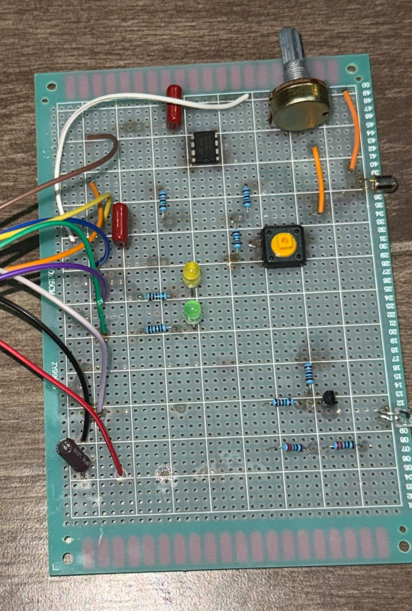
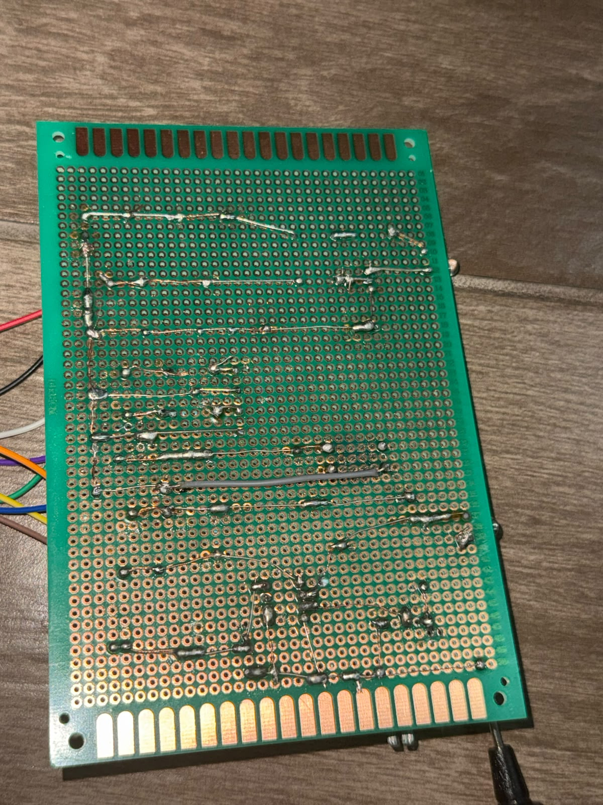
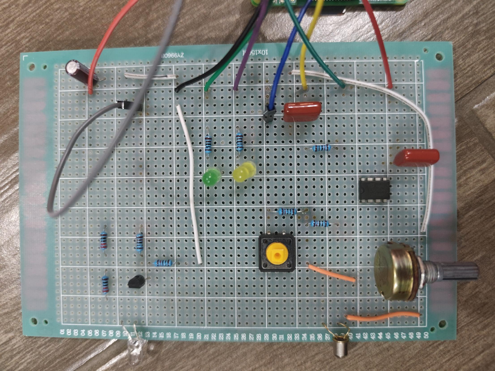
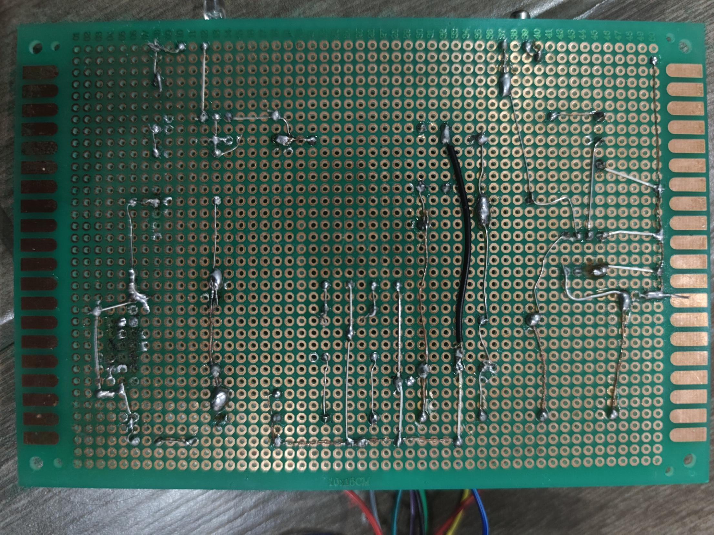
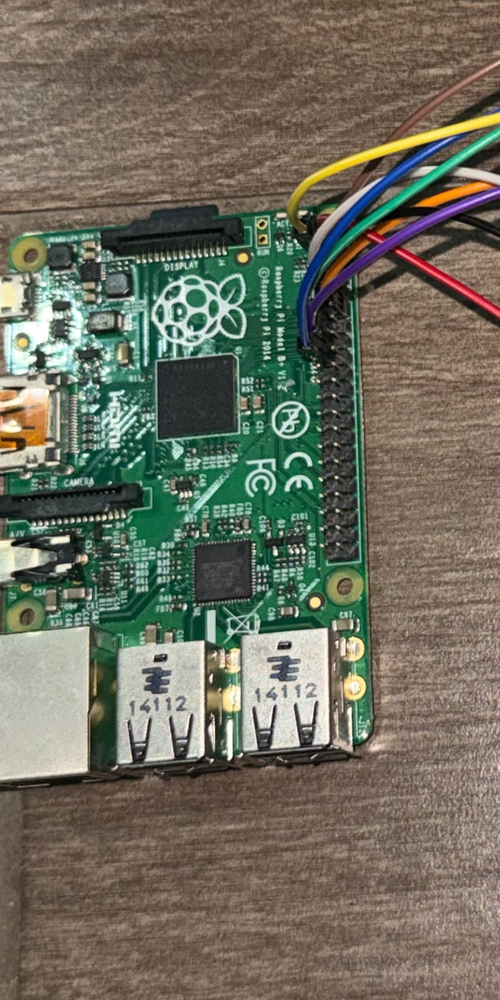
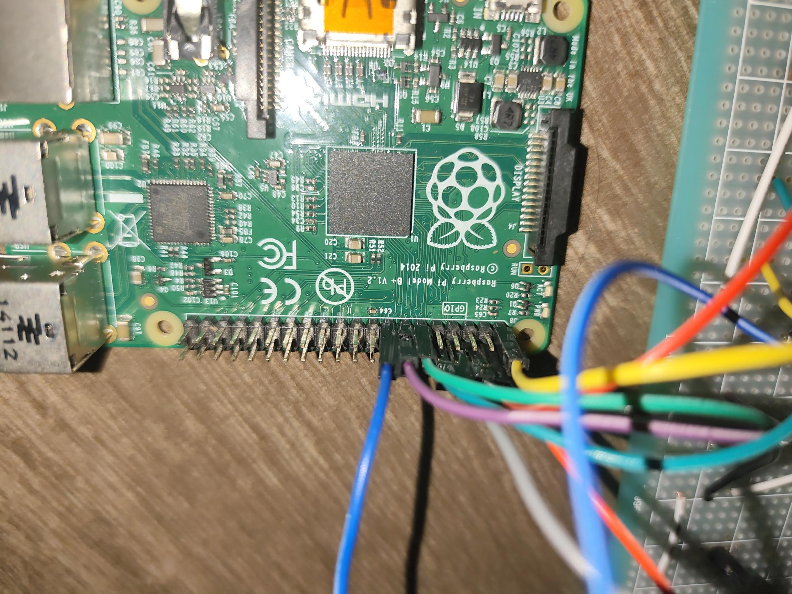

# FaroNet — Documentación del proyecto

**Proyecto 1 · Redes de Computadoras · Tecnológico de Costa Rica · Prof. Kevin Moraga**
Integrantes: Joshua Solís Fuentes · Jesús Andrey Solís Mora
Repositorio: <https://github.com/Josh-SolisF/Fasolis> · rama `cloudfare_try`

La especificación de los protocolos está en el RFC ([`RFC-FaroNet.txt`](RFC-FaroNet.txt)). Los resultados de las
pruebas de cada capa están en el Anexo A.

---

## Índice

1. [Introducción](#1-introducción)
2. [Ambiente de desarrollo](#2-ambiente-de-desarrollo)
3. [Diseño](#3-diseño)
4. [Estructuras de datos y funciones](#4-estructuras-de-datos-y-funciones)
5. [Instrucciones para ejecutar el programa](#5-instrucciones-para-ejecutar-el-programa)
6. [Actividades realizadas por estudiante](#6-actividades-realizadas-por-estudiante)
7. [Autoevaluación](#7-autoevaluación)
8. [Lecciones aprendidas](#8-lecciones-aprendidas)
9. [Bibliografía](#9-bibliografía)
10. [Anexo A. Resultados de las pruebas](#anexo-a-resultados-de-las-pruebas)

---

## 1. Introducción

Cifrar un mensaje protege lo que dice, pero no quién lo dice. Los metadatos (quién habla con quién, cuándo y desde
dónde) bastan para vigilar a una persona aunque nunca se lea el contenido. FaroNet es una red de mensajería pensada
para proteger también esos metadatos, desde el medio físico hasta la salida a Internet.

El problema tiene tres partes:

1. **Un medio físico propio.** Dos Faros, circuitos soldados por nosotros, que intercambian datos por luz
   infrarroja. Cada Faro se conecta a una Raspberry Pi y une dos comunidades que no comparten red.
2. **Una red mesh anónima.** Los nodos se comunican por Wi-Fi, Ethernet o el Faro. Los mensajes viajan por capas
   (enrutamiento tipo cebolla) por al menos tres relays, de modo que ningún nodo intermedio conoce a la vez el origen
   y el destino. Todos los paquetes tienen el mismo tamaño y las direcciones y llaves se pueden rotar.
3. **Una salida controlada a Internet.** Un gateway firma y publica solo los mensajes marcados como públicos en una
   aplicación serverless en Cloudflare Workers: salas en tiempo real, feeds, un buzón muerto y una copia pública del
   directorio, sin guardar registros de quién se conecta.

La estrategia fue elegir en cada paso la opción más simple que cumpliera el enunciado. El Faro no tiene
microcontrolador propio: el UART de la Raspberry Pi modula el LED infrarrojo y un comparador convierte la luz recibida
en niveles lógicos. Todo el software de los Faros, los nodos y el gateway está en Python; el Worker, en TypeScript. El
trabajo se hizo por fases: circuito en protoboard, circuito soldado, Capa 1, mesh y cebolla, gateway y edge, y por
último las pruebas y la documentación.

---

## 2. Ambiente de desarrollo

### 2.1 Software

| Herramienta | Uso |
|---|---|
| Python 3.13 con PyNaCl (libsodium), pySerial y gpiozero | Faro, nodos de la mesh, cebolla, directorio y gateway |
| TypeScript, Node.js y Wrangler | Worker de Cloudflare: desarrollo, pruebas y despliegue |
| Cloudflare Workers y Durable Objects (plan gratuito) | Aplicación pública en el edge |
| Raspberry Pi OS (Raspbian 13 "trixie") | Sistema de las dos Raspberry Pi |
| Visual Studio Code | Editor |
| Git y GitHub | Control de versiones |
| SSH y PowerShell | Acceso a las Raspberry Pi desde la laptop |
| Fritzing | Esquemático y diseño de la protoboard y la perfboard |
| Markdown | Documentación; el RFC en texto ASCII |

### 2.2 Hardware y herramientas físicas

| Herramienta | Uso |
|---|---|
| 2 Raspberry Pi Model B+ | Una por Faro; Soli es además el gateway |
| Protoboard y cables Dupont | Prototipo de los dos circuitos |
| Placa perforada (perfboard) | Circuito final de los dos Faros |
| Cautín y soldadura 60/40 | Soldadura de las placas |
| Multímetro | Continuidad, ausencia de cortos y voltajes |
| Laptop | Programación, acceso por SSH y despliegue |

### 2.3 Depuración

- **Faro:** LEDs indicadores de TX y RX, autoprueba del circuito (`faronet.faro.hardware`) y `medir_enlace.py`, que
  envía datos conocidos y cuenta los bits errados.
- **Mesh:** varios nodos como procesos en una misma máquina antes de repartirlos entre las dos Pi, y la opción
  `--debug` de cada nodo, que muestra el paso de las celdas sin revelar direcciones.
- **Edge:** pruebas del Worker con un entorno falso y `wrangler dev` en local antes de desplegar.
- **Pruebas automáticas:** `unittest` en Python y `node:test` en el Worker.

### 2.4 Lugar de trabajo

El trabajo se realizó en la casa de los integrantes, en un espacio bien iluminado, sin interrupciones y con espacio
suficiente para los dos circuitos y las pruebas a distancia.

### 2.5 Equipo usado en las pruebas

Cada Faro está conectado a una Raspberry Pi por el UART y los GPIO. En este documento las dos Pi se llaman
**Sylos** y **Soli**; Soli es además el gateway hacia Cloudflare.

| | Sylos y Soli (idénticas) |
|---|---|
| Placa | Raspberry Pi Model B+ Rev 1.2 (ARMv6, 1 núcleo, 700 MHz, 426 MiB de RAM) |
| Sistema | Raspbian GNU/Linux 13 (trixie) |
| Python | 3.13.5, con pynacl 1.5.0, pyserial 3.5 y gpiozero 2.0.1 |
| Puerto del Faro | `/dev/serial0` (UART PL011) |
| Red entre nodos | Wi-Fi 802.11 (y el enlace por luz entre los dos Faros) |
| Edge | Cloudflare Workers, plan gratuito: `https://faronet.fasolis.workers.dev` |

---

## 3. Diseño

### 3.1 Arquitectura

```
[Nodo PC] --USB-- [Faro A] ~~~ luz ~~~ [Faro B] --USB-- [Gateway RPi]
   |                                                        |
   +-------- mesh anónima (Ethernet / WiFi / Faro) ---------+
                                                            | HTTPS (firmado Ed25519)
                                                            v
                                                   [Edge: Cloudflare Workers]
                                                            |
                                                 clearnet (salas, feeds, buzón, directorio)
```

### 3.2 Decisiones de diseño

| Decisión | Motivo |
|---|---|
| Sin microcontrolador: el UART de la Pi modula el LED | Menos componentes y nada que programar aparte; el UART ya genera bits de inicio y parada |
| OOK con NRZ a 8N1 | La codificación más simple; el receptor solo distingue luz y oscuridad |
| Comparador LM393 con potenciómetro | Convierte la señal del fototransistor en niveles limpios y permite ajustar el umbral según la distancia |
| Transistor 2N3904 como driver del LED IR | El GPIO no entrega la corriente del LED; el transistor la toma de 5 V |
| Trama de 128 bytes con CRC-16 y ACK por trama | Límite del enunciado; detecta errores y retransmite solo la trama perdida |
| Enlace maestro/esclavo por turnos | La luz es un medio compartido: se evita que los dos Faros transmitan a la vez |
| Vector de distancias con envenenamiento en reversa | Enrutamiento dinámico simple, suficiente para una mesh pequeña |
| Cebolla de 3 relays con paquetes de 512 bytes | Ningún relay conoce origen y destino a la vez; el tamaño fijo no revela el contenido |
| PyNaCl (libsodium) para toda la criptografía | Biblioteca reconocida; Ed25519 y X25519 son rápidos incluso en la Pi B+ |
| Gateway que firma cada petición (Ed25519, marca de tiempo y anti-repetición) | El Worker solo acepta publicaciones del gateway autorizado |
| Cloudflare Workers con Durable Objects | Salas en tiempo real sin servidor propio y sin registros de conexión |
### 3.3 El Faro: componentes y conexión a la Pi

Esquemático en Fritzing: [`Prototipado.fzz.zip`](../Prototipado.fzz.zip). Las coordenadas **(columna, fila)** son las
de la perfboard; los pines para los cables Dupont están en la columna 32.

| Bloque | Componentes | Pin de la perfboard (col, fila) | Pin físico de la Pi |
|---|---|---|---|
| Alimentación | C-5V (desacople de 5 V) | 5V (32,6) y (32,45) | 2 y 4 |
| | C-3V3 (desacople de 3,3 V) | 3V3 (32,35) | 1 |
| | Riel de GND | GND (32,19) | 6 |
| Emisor | LED IR + R-IR, transistor Q-IR (2N3904) + R-BASE + R-REPOSO | TXD (32,13) | 8 (GPIO14) |
| Receptor | Fototransistor + R-FOTO, comparador LM393 + POT (umbral) + C-COMP, R-PULL RX | RXD (32,40) | 10 (GPIO15) |
| Indicador TX | LED verde + R-TX | G17 (32,22) | 11 (GPIO17) |
| Indicador RX | LED amarillo + R-RX | G27 (32,26) | 13 (GPIO27) |
| Botón de pánico | pulsador + R-BOTÓN (pull-up) | G22 (32,30) | 15 (GPIO22) |

### 3.4 Codificación de línea

El Faro usa el **UART de la Pi (8N1)** como modulador: cada bit en alto enciende el LED infrarrojo a través de
Q-IR y cada bit en bajo lo apaga. Es **OOK con codificación NRZ**: 1 bit de inicio, 8 de datos y 1 de parada, 10 bits
en el aire por byte. En reposo el UART deja la línea en alto, así que el LED infrarrojo permanece encendido mientras no
se transmite. El receptor convierte la luz en un nivel lógico con el fototransistor y el comparador LM393, cuyo umbral
se ajusta con el potenciómetro. La justificación de esta elección está en el RFC (sección 3.1).

### 3.5 LEDs indicadores y botón de pánico

**Autoprueba del circuito** (`python3 -m faronet.faro.hardware`):

| Paso | Sylos | Soli |
|---|---|---|
| LED verde (TX) encendido 2 s | Correcto | Correcto |
| LED amarillo (RX) encendido 2 s | Correcto | Correcto |
| Señal de pánico: los dos LEDs parpadean 10 veces y quedan encendidos 1 s | Correcto | Correcto |
| Botón: en reposo se lee "suelto" | Correcto | Correcto |
| Pulsaciones del botón detectadas (cada una repite la señal de pánico) | 4 de 4 | 4 de 4 |

**Botón de pánico real**, con `faro_nodo` en ejecución:

```
[PANICO] LEDs y boton de panico listos
[PANICO] BOTON DE PANICO: borrando estado sensible...
[PANICO] llave del gateway: se borra (gateway_nodo detenido)
[PANICO] llaves borradas: 2 archivo(s); nueva direccion fisica B2C6
```

| Verificación | Sylos | Soli (gateway) |
|---|---|---|
| El nodo se detiene al presionar el botón | Sí | Sí |
| Archivo de llaves del nodo sobrescrito con ceros y borrado | Sí | Sí |
| Llaves de cifrado en memoria olvidadas | Sí | Sí |
| Proceso del gateway detenido y llave del gateway borrada | No aplica | Sí |
| Dirección física rotada y guardada | Sí | Sí |
| Señal de pánico en los LEDs | Sí | Sí |

**Recuperación del gateway.** Tras el botón de pánico, el gateway no puede publicar hasta que se reinstala su llave.
La copia original la conserva el operador; los comandos están en
[`RECUPERAR_LLAVE_GATEWAY.txt`](../RECUPERAR_LLAVE_GATEWAY.txt)
(`powershell -ExecutionPolicy Bypass -File .\scripts\reinstalar_llave_gateway.ps1`). Se probó: la llave reinstalada
coincide con `GATEWAY_PUBKEY` y el Worker vuelve a aceptar publicaciones (HTTP 204). Si la llave pudo haber sido
copiada, se genera una nueva, se actualiza `GATEWAY_PUBKEY` en `edge/wrangler.jsonc` y se redespliega el Worker.

### 3.6 Lista de materiales (BOM)

Precios según las facturas de compra, en colones: el precio unitario es sin IVA y el IVA (13 %) se suma por factura.
**Por Faro** es lo que lleva cada placa; **Total** es lo comprado para los dos Faros, incluidos los repuestos.

#### Componentes del circuito

| # | Componente | Especificación | Referencia en la placa | Por Faro | Total | Precio unit. sin IVA (₡) | Subtotal sin IVA (₡) |
|---:|---|---|---|---:|---:|---:|---:|
| 1 | LED infrarrojo | 5 mm, 940 nm | LED IR | 1 | 4 | 266,00 | 1 064,00 |
| 2 | Fototransistor infrarrojo | 5 mm, 2 patas | FOTO | 1 | 3 | 1 168,14 | 3 504,42 |
| 3 | Base (socket) | DIP-8 | base del LM393 | 1 | 2 | 133,00 | 266,00 |
| 4 | Transistor NPN | 2N3904 | Q-IR | 1 | 3 | 353,98 | 1 061,94 |
| 5 | LED indicador | amarillo, 5 mm | LED RX | 1 | 3 | 97,35 | 292,05 |
| 6 | Condensador electrolítico | 47 µF, 35 V | C-5V | 1 | 1 | 97,35 | 97,35 |
| 7 | Comparador | LM393, DIP-8 | LM393 | 1 | 3 | sin factura | — |
| 8 | Trimmer (potenciómetro de ajuste) | 10 kΩ | POT | 1 | 3 | sin factura | — |
| 9 | Condensador cerámico | 100 nF | C-3V3, C-COMP | 2 | 4 | sin factura | — |
| 10 | Condensador electrolítico | 47 – 470 µF | C-5V (segundo Faro) | — | 1 | sin factura | — |
| 11 | Resistencia | 10 kΩ, ¼ W | R-REPOSO, R-BOTÓN, R-FOTO, R-PULL RX | 4 | 8 | kit | — |
| 12 | Resistencia | 1 kΩ, ¼ W | R-BASE, R-TX, R-RX | 3 | 6 | kit | — |
| 13 | Resistencia | 220 Ω, ¼ W | R-IR (dos en serie = 440 Ω) | 2 | 4 | kit | — |
| 14 | LED indicador | verde, 5 mm | LED TX | 1 | 2 | kit | — |
| 15 | Pulsador con tapa | 12 mm | BOTÓN | 1 | 2 | kit | — |

La numeración de las resistencias en la placa está en [`RESISTENCIAS_numeradas.png`](RESISTENCIAS_numeradas.png).
Con R-IR = 440 Ω, el LED infrarrojo trabaja a unos 8 mA (ver la sección 3.8).

#### Montaje, cableado y equipo

| # | Material | Especificación | Uso | Total | Precio unit. sin IVA (₡) | Subtotal sin IVA (₡) |
|---:|---|---|---|---:|---:|---:|
| 16 | Placa perforada | baquelita, HS-03 | base del circuito soldado | 2 | 1 769,91 | 3 539,82 |
| 17 | Cables Dupont macho–hembra | paquete de 40 | conexión perfboard ↔ Pi | 1 paquete | 4 000,00 | 4 000,00 |
| 18 | Cables Dupont macho–macho | paquete de 20 | prototipo en protoboard | 1 paquete | 3 628,30 | 3 628,30 |
| 19 | Tarjeta microSD | 32 GB, clase 10 | sistema operativo de cada Pi | 2 | 3 982,30 | 7 964,60 |
| 20 | Tira de pines macho | 2,54 mm (9 por placa) | conector de la perfboard | 1 tira | kit | — |
| 21 | Alambre sólido aislado | 22 AWG | puentes en la placa | — | sin factura | — |
| 22 | Soldadura | 60/40, 0,8 mm | soldadura | — | sin factura | — |
| 23 | Raspberry Pi | Model B+ Rev 1.2 | nodo de cada Faro | 2 | préstamo del Laimii | — |
| 24 | Fuente de alimentación | microUSB, 5 V | alimentación de cada Pi | 2 | sin factura | — |

#### Costo total

| Factura | Comercio | Fecha | Artículos | Subtotal sin IVA (₡) | IVA 13 % (₡) | Total (₡) |
|---|---|---|---|---:|---:|---:|
| Ticket 00100001040000080435 | Electrónica CR | 09/10/2026 | LED IR, fototransistores, bases DIP-8, 2N3904, placas | 9 436,18 | 1 226,70 | 10 662,88 |
| Ticket 00100001040000080474 | Electrónica CR | 12/10/2026 | condensador 47 µF, LED amarillos | 389,40 | 50,62 | 440,02 |
| Factura 00300001040000036498 | Electrónica MJ | 12/10/2026 | cables Dupont | 7 628,32 | 991,68 | 8 620,00 |
| Factura 08900001040000042473 | Extremetech | 09/10/2026 | 2 microSD de 32 GB | 7 964,60 | 1 035,40 | 9 000,00 |
| **Total** | | | | **25 418,50** | **3 304,40** | **28 722,90** |

**Costo total de los dos Faros: ₡28 722,90** (unos ₡14 361 por Faro). No incluye las piezas del kit de Arduino, las
Raspberry Pi (préstamo del Laimii) ni las piezas sin factura.

### 3.7 Fotos de los Faros soldados

| Faro | Cara de componentes | Cara de soldadura |
|---|---|---|
| Sylos | [](fotos/Sylos_cara_superior.jpg) | [](fotos/Sylos_cara_inferior.jpg) |
| Soli | [](fotos/Soli_cara_superior.jpg) | [](fotos/Soli_cara_inferior.jpg) |

Conexión de cada Faro a los pines de la Pi:

| Sylos | Soli |
|---|---|
| [](fotos/Sylos_conexion_pines.jpg) | [](fotos/Soli_conexion_pines.jpg) |

### 3.8 Bitácora de pruebas con multímetro

Detalle, puntos de medición y método en [`BITACORA_MULTIMETRO.md`](BITACORA_MULTIMETRO.md). Mediciones en voltaje DC
con la placa energizada; punta negra en GND.

| # | Qué se mide | Punto | Esperado | Sylos | Soli |
|---|---|---|---|---:|---:|
| 1 | Alimentación de 5 V (sin corto a GND) | 5V (32,6) | 4,75 – 5,25 V | 4,94 V | 5,04 V |
| 2 | Alimentación de 3,3 V (sin corto a GND) | 3V3 (32,35) | 3,20 – 3,40 V | 3,31 V | 3,27 V |
| 3 | Señal TXD en reposo | TXD (32,13) | ≈ 3,3 V | 3,23 V | 3,23 V |
| 4 | Colector de Q-IR (transistor saturado) | (9,12) | ≈ 0 V | 26 mV | 30 mV |
| 5 | Caída en una resistencia de 220 Ω de R-IR | entre (10,8) y (6,8) | — | 1,80 V | 1,90 V |
| 6 | Umbral del receptor (cursor del POT) | (9,45) | 0 – 3,3 V | 0,70 V | 1,00 V |
| 7 | RXD con luz del otro Faro | RXD (32,40) | ≈ 3,3 V | 3,30 V | 3,31 V |
| 8 | RXD con el fototransistor tapado | RXD (32,40) | ≈ 0 V | 40 mV | 40 mV |
| 9 | Botón suelto / presionado | G22 (32,30) | ≈ 3,3 V / 0 V | 3,30 V / 0 V | 3,31 V / 0 V |

| Cálculo | Sylos | Soli |
|---|---:|---:|
| Corriente del LED infrarrojo = medición 5 / 220 Ω | 8,2 mA | 8,6 mA |
| Voltaje en el LED infrarrojo = med. 1 − 2 × med. 5 − med. 4 | 1,31 V | 1,21 V |

Los dos Faros cumplen: no hay cortos entre VCC y GND, todas las pistas llevan el voltaje esperado y el LED infrarrojo
trabaja dentro de sus valores normales.

### 3.9 Modelo de amenazas

Objetivo: que ningún adversario pueda vincular a un usuario con el contenido y el destinatario de sus mensajes.

| Adversario | Qué puede ver | Defensa en FaroNet |
|---|---|---|
| Nodo malicioso de la mesh (relay) | El paquete que recibe y a qué vecino lo reenvía | Cebolla de 3 relays: cada relay solo conoce el anterior y el siguiente; el último no puede abrir el mensaje sellado |
| Observador del medio (luz, Wi-Fi) | Cuándo se transmite y cuántos paquetes pasan | Cifrado extremo a extremo; todos los paquetes miden 512 bytes y no llevan origen |
| Directorio de nodos | Las fichas que se publican | Las fichas van firmadas y cada nodo verifica las firmas por su cuenta; el directorio no guarda direcciones IP |
| Operador del gateway | Los mensajes públicos que salen a Internet | No sabe qué nodo los originó, porque llegan por la cebolla; los mensajes privados nunca pasan por él |
| Proveedor del edge (Cloudflare) | Las peticiones que llegan al Worker | Solo recibe mensajes públicos, firmados por el gateway; el Worker no registra IP ni identificadores |
| Atacante que imita al gateway o repite peticiones | Peticiones capturadas | Firma Ed25519 con marca de tiempo y protección contra repetición (401 / 409) |
| Abuso del servicio público | — | Límite de peticiones por cliente (429) |
| Acceso físico al Faro | La Raspberry Pi y sus archivos | Botón de pánico: borra las llaves (incluida la del gateway), olvida las llaves en memoria y rota la dirección física |
| Seguimiento por identificadores fijos | Dirección física y llaves de cifrado | Dirección física y llaves de cifrado rotables |

Fuera del alcance: un adversario que observe toda la red a la vez y correlacione tiempos de envío y recepción, y el
compromiso del sistema operativo de la Raspberry Pi.

---

## 4. Estructuras de datos y funciones

El código fuente está documentado: cada módulo empieza con un docstring que explica su función, su uso y sus
decisiones de privacidad, y las funciones principales tienen su propio docstring.

### 4.1 Estructura

| Carpeta / archivo | Líneas | Función |
|---|---:|---|
| `faronet/faro/capa1.py` | 385 | Trama, CRC, decodificador y `DispositivoLuzAdaptador` (maestro/esclavo con ACK) |
| `faronet/faro/enlace_faro.py` | 305 | El Faro como un vecino más de la mesh (hilo, cola, difusión → ACK) |
| `faronet/faro/hardware.py` | 254 | LEDs TX/RX, botón de pánico, borrado seguro |
| `faronet/mesh/paquete.py` | 72 | Paquete de 512 bytes de tamaño fijo |
| `faronet/mesh/nodo.py` | 632 | Nodo: vecinos TCP, vector de distancias, terminal |
| `faronet/mesh/cebolla.py` | 466 | Enrutamiento por capas (tipo Sphinx simplificado) |
| `faronet/mesh/identidad.py` | 170 | Llaves de firma y de cifrado (rotables) y fichas |
| `faronet/mesh/directorio.py` | 210 | Directorio de fichas firmadas |
| `faronet/herramientas/*.py` | 9 programas | `enviar`, `recibir`, `medir_enlace`, `faro_nodo`, `gateway`, `gateway_nodo`, `buzon` |
| `edge/src/*.ts` | 883 | Worker: `index`, `auth`, `control`, `sala`, `feed`, `buzon`, `directorio` |
| `pruebas/*.py` | 84 pruebas | Capa 1 (18), cebolla (48), gateway/buzón (10), scripts (8) |
| `edge/pruebas/edge.test.ts` | 38 pruebas | Worker con entorno falso |

### 4.2 Trama de Capa 1 (`capa1.py`)

```
 Sincronía(2)=AA 55 | Versión(1) | Tipo(1) | Destino(2) | Origen(2) |
 Secuencia(1) | Fragmento(1) | Longitud(1) | Datos(0..115) | CRC-16(2)
```
- Tamaño máximo: 2 + 9 + 115 + 2 = **128 bytes** (límite del enunciado). Un ACK mide 13 bytes.
- Tipos: `1` datos · `2` ACK · `3` trama externa (creada fuera del Faro; el Faro solo la transporta).
- Destino `FFFF` = difusión (sin ACK). Fragmento: bit 7 = "vienen más", bits 0–6 = índice.
- CRC-16/CCITT (`binascii.crc_hqx`, valor inicial 0) desde Versión hasta Datos.

```python
def codificar(t: Trama) -> bytes:
    """Trama -> bytes listos para escribir en el puerto serie."""
    if len(t.datos) > MAX_DATOS:
        raise ValueError(f"datos de {len(t.datos)} bytes; el maximo es {MAX_DATOS}")
    cuerpo = struct.pack(
        _FORMATO_ENCABEZADO,
        VERSION, t.tipo, t.destino, t.origen, t.secuencia, t.fragmento, len(t.datos),
    ) + bytes(t.datos)
    crc = binascii.crc_hqx(cuerpo, 0)
    return SINCRONIA + cuerpo + struct.pack(">H", crc)
```

**Acceso al medio:** semidúplex maestro/esclavo. El maestro envía cada fragmento y espera su ACK, con reintentos. Al
transmitir descarta su propio eco (`guarda_eco`), y el esclavo espera `retardo_ack` antes de contestar.
Los tiempos se escalan con la velocidad:

```python
t_byte = 10 / baudios                              # 8N1
guarda_eco   = max(0.01, 4 * t_byte)
retardo_ack  = 2 * guarda_eco
timeout_byte = max(0.5, 30 * t_byte)               # el driver entrega bytes en grupos
```

**Dirección física:** 2 bytes aleatorios (evita `0000` y `FFFF`), guardados en `~/.faronet_direccion`
(memoria no volátil). Rotarla es reescribir el archivo (`direccion_persistente(rotar=True)`).

### 4.3 Paquete de la mesh (`paquete.py`)

```
   0        1        2                 6        8                     512
   +--------+--------+-----------------+--------+---------------------+
   |Versión |  Tipo  |   Id circuito   |Longitud| Contenido + relleno |
   +--------+--------+-----------------+--------+---------------------+
```
Todos los paquetes miden **512 bytes**. El relleno es aleatorio y sirve para minimizar los metadatos.
Tipos: `1` HOLA · `2` DATOS · `3` RUTAS · `4` CEBOLLA · `5` MENSAJE · `10–14` directorio.
El paquete de datos lleva destino pero **no origen**.

### 4.4 Cebolla (`cebolla.py`)

- El cliente elige **3 relays** del directorio y envuelve el mensaje en una capa por relay.
- La llave de cada capa sale de un DH X25519 efímero con la llave de cifrado del relay. El flujo
  XSalsa20 (keystream de SecretBox) conserva el tamaño, así que la celda mide lo mismo en todo el camino.
- **MAC por salto** (BLAKE2b con llave, 8 bytes) sobre todo el bloque. Si un relay altera un bit, el siguiente lo detecta.
- **Relleno determinista** tipo Sphinx (*filler*), para que no haya bytes que un relay pueda cambiar sin ser detectado.
- Mensaje final: **SealedBox** hacia el destinatario (extremo a extremo), en tres variantes:
  `anónimo` (sin remitente), `firmado` (remitente autenticado con Box, visible solo para el destinatario)
  y `público` (tema + texto, sellado hacia el gateway).
- Anti-repetición: cada relay recuerda las llaves efímeras ya vistas.
- Solo se usa PyNaCl; **no hay primitivas criptográficas propias**.

```
Celda: Versión(1) | Efímera(32) | MAC(8) | Bloque(R)
Cabecera de cada salto: Siguiente(16) | EfímeraSig(32) | MACsig(8)
```

Limitaciones conocidas, documentadas en el propio código:
- El secreto hacia adelante es parcial: depende de la rotación de llaves.
- Los MAC son de 64 bits.
- No hay mezcla ni retardos, así que un observador global puede correlacionar por tiempos.

### 4.5 Firma del gateway (`gateway.py` ↔ `edge/src/auth.ts`)

```python
def firmar(llave: SigningKey, metodo: str, ruta: str, ts: int, cuerpo: bytes) -> str:
    """Debe coincidir con verificarGateway() de edge/src/auth.ts."""
    mensaje = f"{metodo}\n{ruta}\n{ts}\n{hashlib.sha256(cuerpo).hexdigest()}".encode()
    return llave.sign(mensaje).signature.hex()
```
Encabezados `X-Faro-Ts` y `X-Faro-Firma`. El Worker acepta una ventana de 60 s y rechaza con 409 una firma ya vista.

### 4.6 Worker (`edge/`)

| Ruta | Quién | Qué |
|---|---|---|
| `POST /gateway/publicar` | gateway (firmado) | publica en la sala de un tema |
| `POST /gateway/directorio` | gateway (firmado) | réplica del directorio (cada ficha se re-verifica) |
| `GET /`, `/sala/:tema` | navegador | páginas con CSP + nonce |
| `GET /sala/:tema/ws` | navegador | WebSocket en vivo (Durable Object por tema) |
| `GET /sala/:tema/historial`, `/feed.atom` | cualquiera | JSON y feed Atom |
| `GET /directorio[/:nombre]` | cualquiera | réplica de solo lectura |
| `PUT/GET /buzon/:id` | cualquiera | buzón muerto: blob de 1024 B, se borra al leer, TTL 24 h |

---

## 5. Instrucciones para ejecutar el programa

Todos los comandos se corren desde la raíz del repositorio.

### 5.1 Preparar cada Raspberry Pi

El Faro no tiene microcontrolador, así que no hay firmware que flashear: el programa del Faro es la biblioteca
`faronet/faro/capa1.py`, que corre en la Raspberry Pi. Solo hay que habilitar el UART y conectar la placa.

```bash
# 1. Habilitar el UART: sudo raspi-config -> Interface Options -> Serial Port
#    "login shell over serial": No · "serial port hardware": Sí. Reiniciar.
# 2. Conectar la perfboard a los pines 1, 2, 4, 6, 8, 10, 11, 13 y 15 (tabla de la sección 3.3).
# 3. Dependencias y código
sudo apt install python3-nacl python3-serial python3-gpiozero python3-lgpio
git clone https://github.com/Josh-SolisF/Fasolis.git && cd Fasolis
# 4. Comprobar el circuito y el código
python3 -m faronet.faro.hardware          # autoprueba de LEDs y botón
python3 -m unittest discover -v           # 84 pruebas
```

### 5.2 Faro: enviar, recibir y medir

```bash
python3 -m faronet.herramientas.recibir --una                      # en una Pi (muestra su dirección física)
python3 -m faronet.herramientas.enviar <DIRECCION> --texto "Hola"  # en la otra

# BER y tasa efectiva (en las dos Pi a la vez)
python3 -m faronet.herramientas.medir_enlace receptor --baudios 1800 --bytes 5000 --distancia 100cm
python3 -m faronet.herramientas.medir_enlace emisor <DIRECCION> --baudios 1800 --bytes 5000 --distancia 100cm
```

### 5.3 Mesh, cebolla y Faro como enlace

`<IP_SYLOS>` es la dirección IP de la Pi donde corre el directorio.

```bash
python3 -m faronet.mesh.directorio --puerto 9000
python3 -m faronet.mesh.nodo --nombre S1 --puerto 9001 --directorio <IP_SYLOS>:9000
python3 -m faronet.mesh.nodo --nombre L1 --puerto 9101 --vecino <IP_SYLOS>:9003 --directorio <IP_SYLOS>:9000
#   comandos en el nodo: rutas | directorio | anonimo L3 hola | firmado L3 hola | rotarllaves

python3 -m faronet.herramientas.faro_nodo --nombre PA --puerto 9201 --baudios 1800 --intervalo-rutas 30 --directorio <IP_SYLOS>:9000
#   comandos extra: faro | rotar
```

### 5.4 Desplegar el Worker y correr el gateway

```bash
python3 -m faronet.herramientas.gateway --mostrar-llave   # llave pública: va en GATEWAY_PUBKEY (edge/wrangler.jsonc)
cd edge
npm install
npm run probar                                            # 38 pruebas
npx wrangler deploy                                       # despliegue en Cloudflare
cd ..

python3 -m faronet.herramientas.gateway_nodo --nombre GW --puerto 9110 --vecino 127.0.0.1:9102 \
        --directorio <IP_SYLOS>:9000 --edge https://faronet.fasolis.workers.dev
#   desde cualquier nodo: publico GW general hola

python3 -m faronet.herramientas.buzon --edge https://faronet.fasolis.workers.dev depositar --secreto "<secreto>" "mensaje"
python3 -m faronet.herramientas.buzon --edge https://faronet.fasolis.workers.dev recoger --secreto "<secreto>"
```

Cada programa tiene `--help` con sus opciones.

---

## 6. Actividades realizadas por estudiante

Las actividades de programación se hicieron en conjunto; sus fechas son las de los commits en GitHub.

| Fecha | Actividad | Joshua | Jesús |
|---|---|---:|---:|
| 29/09/2026 | Kick-off: documento inicial y creación del repositorio | 3 h | 3 h |
| 10/10/2026 | Diseño de la protoboard | 4 h | |
| 10/10/2026 | Instalación del sistema en las Raspberry Pi, arranque y conexión por SSH | | 2 h |
| 10/10/2026 | Capa 1: protocolo de envío y recepción | 4 h | 4 h |
| 11/10/2026 | Montaje de la protoboard y primeras pruebas | 9 h | 9 h |
| 11/10/2026 | Réplica de la protoboard y pruebas de conexión | 10 h | |
| 12/10/2026 | Capa 1: ajustes a la trama y al ACK | 2 h | 2 h |
| 19/10/2026 | Mesh: enrutamiento por vector de distancias | 5 h | 5 h |
| 20/10/2026 | Diseño de la perfboard | 1 h | |
| 20/10/2026 | Pruebas del hardware en las Raspberry Pi | 2 h | 2 h |
| 22/10/2026 | Cebolla: primera implementación y reorganización del código | 5 h | 5 h |
| 23/10/2026 | Cebolla completa e inicio del Worker de Cloudflare | 5 h | 5 h |
| 24/10/2026 | Worker completo y despliegue en Cloudflare | 6 h | 6 h |
| 25/10/2026 | Corrección del diseño de la perfboard | 1 h | |
| 26/10/2026 | Actualización del README | 1 h | 1 h |
| 27/10/2026 | Curso de soldadura | 2 h | 2 h |
| 28/10/2026 | Soldadura del primer Faro | 6 h | 6 h |
| 30/10/2026 | Soldadura del segundo Faro y pruebas de conexión | 10 h | 10 h |
| 01/11/2026 | Pruebas de todo el sistema, mediciones por distancia, documentación y últimos detalles | 12 h | 12 h |
| | **Total** | **88 h** | **74 h** |

---

## 7. Autoevaluación

### 7.1 Estado final

El proyecto está completo y funcionando:

- Los dos Faros están soldados en perfboard, con LEDs de TX y RX y botón de pánico, y se comunican en los dos
  sentidos de 7,5 cm a 100 cm, con hasta 2105 bit/s de carga útil.
- La mesh funciona sobre Wi-Fi y sobre la luz, con enrutamiento dinámico, directorio firmado y mensajes anónimos por
  3 relays.
- El gateway publica en el Worker de Cloudflare (`https://faronet.fasolis.workers.dev`): salas en tiempo real, feed
  Atom, buzón muerto, directorio público y límite de peticiones.
- Pasan las 84 pruebas de Python y las 38 del Worker. El RFC, el BOM, la bitácora de multímetro, el esquemático y las
  fotos están en `docs/`.

### 7.2 Problemas encontrados

- **Umbral del receptor.** Un mismo ajuste del potenciómetro no sirve para todas las distancias: de cerca el receptor
  recibe demasiada luz y de lejos muy poca. Se ajustó el umbral para cada rango de distancia.
- **Primera experiencia soldando.** Ninguno de los dos había soldado antes; se tomó un curso de soldadura y se verificó
  cada placa con el multímetro.
- **Cloudflare rechazaba al buzón.** Las peticiones sin cabecera `User-Agent` recibían un error 403 de Cloudflare; se
  agregó la cabecera al cliente.
- **Llave del gateway tras el botón de pánico.** Al borrarla, el gateway deja de publicar; se dejó un script para
  reinstalarla.

### 7.3 Limitaciones

- La velocidad máxima depende de la distancia: 3600 baudios entre 15 y 30 cm, pero 1800 baudios a 100 cm.
- El enlace por luz es semidúplex: los Faros transmiten por turnos.
- Un paquete de 512 bytes tarda unos 4,2 s en cruzar la luz a 1800 baudios, así que un mensaje anónimo que cruza
  varias veces tarda de 9 a 22 s.
- El umbral del receptor se ajusta a mano con el potenciómetro.
- El directorio de nodos se consulta por Wi-Fi.

### 7.4 Reporte de commits

Todos los commits los subió Joshua, porque los dos integrantes trabajaron juntos, en el mismo ambiente y desde la
misma computadora. Los autores `Josh-SolisF`, `Joshua Solís Fuentes` y `josh_lis` son la misma cuenta.

| Commit | Fecha | Descripción |
|---|---|---|
| `9b7adb8` | 29/09/2026 | first commit |
| `9cccd50` | 29/09/2026 | Initial Kickoff |
| `8a06b9f` | 10/10/2026 | Send and receive protocol |
| `8e4f454` | 12/10/2026 | Update capa1.py |
| `b307b3a` | 12/10/2026 | Update capa1.py |
| `7e58a85` | 19/10/2026 | Enrutamiento por vector de distancias con envenenamiento en reversa y TTL |
| `927eb3b` | 20/10/2026 | Hardware Test for raspberrys |
| `8f72071` | 22/10/2026 | Onion early implementation |
| `eb61c03` | 22/10/2026 | Refactor of files |
| `a434154` | 23/10/2026 | Working on onion... |
| `af31eda` | 23/10/2026 | Created cloudfare |
| `fb91891` | 24/10/2026 | edge: completa el Worker y lo despliega en Cloudflare |
| `b1bf882` | 26/10/2026 | readme Update |
| `36c6c4f` | 01/11/2026 | finished project |

### 7.5 Calificación según la rúbrica

| Rubro | Peso | Calificación (0 – 10) |
|---|---:|---:|
| Hardware: Faro soldado (esquemático, BOM, calidad de soldadura, pruebas) | 25 % | 9 |
| Capa 1: protocolo físico y biblioteca `DispositivoLuzAdaptador` | 10 % | 10 |
| Capas 2 y 3: FaroNet mesh anónima y directorio de nodos | 15 % | 10 |
| Privacidad: modelo de amenazas, cifrado, relleno y botón de pánico | 10 % | 10 |
| Capa 7: aplicación anónima a través de FaroNet | 5 % | 9 |
| Capa 7: aplicación pública en el edge (Workers) | 25 % | 10 |
| RFC | 5 % | 9 |
| Documentación | 5 % | 9 |
| Kick-off | extra | 10 |

### 7.6 Autoevaluación de aprendizaje

Escala: [1] Muy malo, [2] Malo, [3] Regular, [4] Bueno, [5] Muy bueno.

| Rubro | Calificación |
|---|---:|
| Aprendizaje de soldadura y hardware | 5 |
| Aprendizaje de la capa física | 5 |
| Aprendizaje de enrutamiento en redes mesh | 4 |
| Aprendizaje de privacidad y anonimato | 5 |
| Aprendizaje de serverless en el edge | 4 |
| Aprendizaje de redacción de RFCs | 4 |

---

## 8. Lecciones aprendidas

- Probar el circuito completo en protoboard antes de soldar: en la perfboard cada corrección cuesta mucho más.
- Hacer un diseño de la perfboard antes de soldar y medir con el multímetro cada etapa terminada.
- Medir con datos conocidos desde el inicio: contar bits errados dice mucho más que ver si un mensaje llegó.
- Probar la mesh con varios nodos en una sola máquina antes de llevarla a las Raspberry Pi y al Faro.
- Usar bibliotecas criptográficas reconocidas en lugar de implementar algoritmos propios.
- Escribir pruebas automáticas desde el principio; permiten cambiar el código sin miedo a romper otra capa.
- Empezar el RFC y la documentación durante el proyecto y no al final.

---

## 9. Bibliografía

- Raspberry Pi Ltd. *Raspberry Pi Documentation*. <https://www.raspberrypi.com/documentation/>
- Fritzing. *Fritzing: Electronics made easy*. <https://fritzing.org/>
- Cloudflare. *Cloudflare Workers Documentation*. <https://developers.cloudflare.com/workers/>
- Cloudflare. *Durable Objects Documentation*. <https://developers.cloudflare.com/durable-objects/>
- Python Software Foundation. *Python 3 Documentation*. <https://docs.python.org/3/>
- PyNaCl. *PyNaCl Documentation*. <https://pynacl.readthedocs.io/>
- pySerial. *pySerial Documentation*. <https://pyserial.readthedocs.io/>
- gpiozero. *gpiozero Documentation*. <https://gpiozero.readthedocs.io/>
- Texas Instruments. *LM393 Dual Comparator, hoja de datos*. <https://www.ti.com/product/LM393>
- onsemi. *2N3904 NPN Transistor, hoja de datos*. <https://www.onsemi.com/>
- Flanagan, H. y Ginoza, S. *RFC 7322: RFC Style Guide*. IETF, 2014. <https://www.rfc-editor.org/rfc/rfc7322>
- Bradner, S. *RFC 2119: Key words for use in RFCs to Indicate Requirement Levels*. IETF, 1997.
  <https://www.rfc-editor.org/rfc/rfc2119>

---

## Anexo A. Resultados de las pruebas

### A.1 Resumen de resultados

| Área | Resultado |
|---|---|
| Pruebas automáticas | 84/84 pruebas de Python en las dos Raspberry Pi; 38/38 pruebas del Worker |
| Enlace por luz (Capa 1) | Funciona en los dos sentidos a 7,5, 15, 30, 65 y 100 cm, con BER 0 en 40 000 bits por sentido a la velocidad máxima de cada distancia |
| Tasa efectiva máxima | 2105 bit/s a 15 y 30 cm (3600 baudios); 1065 bit/s a 100 cm (1800 baudios) |
| Faro como enlace de la mesh | Los dos Faros forman un enlace de la mesh solo por luz; mensajes directos, anónimos y firmados lo cruzan sin paquetes perdidos |
| Mesh y enrutamiento por capas | Rutas de hasta 5 saltos entre las dos Pi; mensajes anónimos por 3 relays en 0,31 s sobre Wi-Fi; ningún relay ve origen y destino a la vez |
| Gateway y Cloudflare | Un mensaje público sale de la mesh y llega a la sala de Cloudflare en ~1 s; firmas, anti-repetición, rate limit, buzón, feed y directorio público verificados |
| Privacidad | Paquetes de tamaño fijo, sin origen; direcciones físicas y llaves rotables; ningún registro con direcciones IP |
| Botón de pánico | Borra las llaves (incluida la del gateway), rota la dirección física y lo indica con los LEDs, en los dos Faros |
| Bitácora de multímetro | Los dos Faros sin cortos y con todos los voltajes en su rango |
| Costo de los dos Faros | ₡28 722,90 según las facturas |

### A.2 Pruebas automáticas

#### A.2.1 Python en las Raspberry Pi (84 pruebas)

```bash
python3 -m unittest discover -v
```

| Pi | Resultado |
|---|---|
| Sylos | 84 pruebas, todas correctas |
| Soli | 84 pruebas, todas correctas |

Cubren la Capa 1 (codificación, CRC, fragmentación, ACK, duplicados, trama externa), la cebolla (recorrido por 3
relays, relay equivocado, celda alterada, repetición, rotación de llaves, tamaños fijos, versión desconocida), el
gateway y el buzón (firma por ruta, blobs de tamaño fijo, secreto equivocado) y las herramientas de terminal.

#### A.2.2 Worker de Cloudflare (38 pruebas)

```
ok 1 - relay del gateway          (8)   ok 5 - limite de peticiones     (3)
ok 2 - salas y feed               (6)   ok 6 - politica de no registro  (2)
ok 3 - buzon muerto               (6)   ok 7 - paginas HTML             (3)
ok 4 - directorio publico        (10)
# tests 38 · suites 7 · pass 38 · fail 0
```

### A.3 Capa 1: tasa efectiva y BER por distancia

#### A.3.1 Método

Faros frente a frente, medidos con `medir_enlace.py` en los dos sentidos (Sylos → Soli y Soli → Sylos). Las
mediciones de 7,5, 15, 30 y 65 cm se hicieron en interior con luz ambiente normal; la de 100 cm, en un cuarto a
oscuras, sin otras fuentes de luz que pudieran afectar la comunicación.

- **BER**: el emisor manda bytes pseudoaleatorios conocidos, sin trama; el receptor cuenta los bits distintos (un
  byte perdido cuenta como 8 bits errados). Para la velocidad máxima de cada distancia se usaron 5000 bytes
  (40 000 bits) por sentido. Con 0 errores en *n* bits, la cota superior al 95 % es BER < 3/*n*: con 40 000 bits,
  **BER < 7,5 × 10⁻⁵**.
- **Tasa efectiva**: 1000 bytes de carga útil enviados con el protocolo completo (9 tramas con CRC, ACK por trama y
  reintentos). Tasa = bits de carga útil / tiempo hasta el último ACK.

El umbral del receptor (potenciómetro) se ajustó para 100 cm, 65 cm y 30 cm; las mediciones de 15 cm y 7,5 cm se
hicieron con el ajuste de 30 cm.

#### A.3.2 Resumen por distancia

| Distancia | Velocidad máxima confiable | Tasa efectiva con ACK (los dos sentidos) | BER a esa velocidad (los dos sentidos) |
|---|---:|---:|---|
| 7,5 cm | 3000 baudios | 1762 bit/s | 0 en 40 000 bits (< 7,5 × 10⁻⁵) |
| 15 cm | 3600 baudios | 2104 – 2107 bit/s | 0 en 40 000 bits (< 7,5 × 10⁻⁵) |
| 30 cm | 3600 baudios | 2103 – 2105 bit/s | 0 en 40 000 bits (< 7,5 × 10⁻⁵) |
| 65 cm | 2700 baudios | 1587 – 1592 bit/s | 0 en 40 000 bits (< 7,5 × 10⁻⁵) |
| 100 cm | 1800 baudios | 1065 bit/s | 0 en 40 000 bits (< 7,5 × 10⁻⁵) |

La eficiencia es de 58 – 59 % de la velocidad del enlace en todas las distancias, porque depende solo del formato de
trama: cada trama de 115 bytes de datos lleva 13 bytes de encabezado y CRC, cada byte ocupa 10 bits en el aire y
cada trama espera su ACK de 13 bytes. Entre 15 y 30 cm el límite es la velocidad de respuesta del fototransistor y
del comparador; más lejos, la cantidad de luz que llega; a 7,5 cm, el exceso de luz.

#### A.3.3 Detalle por distancia

Tasa efectiva con el protocolo completo (1000 bytes, 9 tramas). "Falla" significa que el mensaje no se completó.

**100 cm** (cuarto a oscuras)

| Baudios | Sylos → Soli | Soli → Sylos |
|---:|---|---|
| 1200 | 712 bit/s | 712 bit/s |
| 1500 | 888 bit/s | 889 bit/s |
| 1800 | 1065 bit/s | 1065 bit/s |
| 2400 | falla (se pierden ACK) | falla |

BER: 1800 bd, 0 en 40 000 bits en cada sentido. 2400 bd: 0 en 16 000 bits (Sylos → Soli) y 74 en 16 000 bits
(4,6 × 10⁻³, Soli → Sylos).

**65 cm** (luz ambiente)

| Baudios | Sylos → Soli | Soli → Sylos |
|---:|---|---|
| 1800 | 1063 bit/s | 1064 bit/s |
| 2400 | 1415 bit/s | 1413 bit/s |
| 2700 | 1588 – 1592 bit/s | 1587 – 1590 bit/s |
| 3000 | falla (BER 3,75 × 10⁻⁴) | falla |

BER: 2700 bd, 0 en 40 000 bits en cada sentido.

**30 cm** (luz ambiente)

| Baudios | Sylos → Soli | Soli → Sylos |
|---:|---|---|
| 2700 | 1589 bit/s | 1590 bit/s |
| 3000 | 1760 bit/s | 1763 bit/s |
| 3600 | 2103 bit/s | 2105 bit/s |
| 4200 | falla (BER 1,23 × 10⁻²) | falla |
| 4800 | falla | falla |

BER: 3600 bd, 0 en 40 000 bits en cada sentido.

**15 cm** (luz ambiente)

| Baudios | Sylos → Soli | Soli → Sylos |
|---:|---|---|
| 3600 | 2104 – 2106 bit/s | 2107 bit/s |
| 4200 | 2445 bit/s | 1386 – 2443 bit/s (con retransmisiones; BER 2,5 × 10⁻²) |
| 4800 | falla | falla |

BER: 3600 bd, 0 en 40 000 bits en cada sentido. A 4200 bd el sentido Soli → Sylos no es confiable.

**7,5 cm** (luz ambiente)

| Baudios | Sylos → Soli | Soli → Sylos |
|---:|---|---|
| 3000 | 1762 bit/s | 1762 bit/s |
| 3600 | BER 4,6 × 10⁻² | BER 1,7 × 10⁻² |
| 4200 | falla | falla |

BER: 3000 bd, 0 en 40 000 bits en cada sentido.

Todas las transferencias completas a la velocidad máxima de cada distancia llegaron con el contenido correcto y sin
retransmisiones.

### A.4 Capas 2 y 3: mesh y enrutamiento por capas

#### A.4.1 Mesh sobre Wi-Fi entre las dos Raspberry Pi

Seis nodos repartidos entre las dos Pi (S1 – S3 en Sylos, L1 – L3 en Soli), con el directorio en Sylos:

```
        Sylos                                          Soli
 [S1] -- [S2] -- [S3] ======= Wi-Fi ======= [L1] -- [L2] -- [L3]
 [Directorio]
```

**Enrutamiento y directorio**

```
[S1] tabla de rutas:
    L1: 3 salto(s) via S2
    L2: 4 salto(s) via S2
    L3: 5 salto(s) via S2
    S2: 1 salto(s) via S2
    S3: 2 salto(s) via S2
[S1] directorio: 6 ficha(s) con firma valida
```

**Mensajes**

| Prueba | Comando | Resultado en el destino |
|---|---|---|
| Directo | `L3 hola-directo-desde-S1` | `[L3] mensaje recibido: hola-directo-desde-S1` |
| Anónimo (cebolla) | `anonimo L3 …` | `[L3] mensaje ANONIMO recibido: …` (sin remitente) |
| Firmado | `firmado L3 …` | `[L3] mensaje de S1 (verificado): …` |
| Respuesta firmada | (en L3) `firmado S1 …` | `[S1] mensaje de L3 (verificado): …` |
| Rotación de la llave de cifrado | (en L3) `rotarllaves` y luego un mensaje anónimo | el mensaje llega con la llave nueva |

**Qué ve cada relay.** Mensaje `anonimo L3 prueba-de-relays` desde S1; la cebolla eligió S3 → L1 → L2:

```
[S3] (debug) reenviando celda al siguiente relay
[L1] (debug) reenviando celda al siguiente relay
[L2] (debug) soy el ultimo relay; entregando el mensaje sellado
[L3] mensaje ANONIMO recibido: prueba-de-relays
```

Ningún relay registra el origen. Solo el último conoce el destino, y no puede leer el mensaje sellado.

**Latencia**

| Tipo | Medidas | Promedio |
|---|---|---|
| Anónimo, 3 relays (la celda cruza entre las dos Pi) | 0,31 · 0,31 · 0,30 · 0,33 · 0,31 s | 0,31 s |
| Directo, 2 saltos | 0,09 · 0,09 · 0,09 s | 0,09 s |

#### A.4.2 Mesh sobre la luz: los Faros como enlace

Los dos grupos de nodos se unen **solo por los Faros**, a 1800 baudios; el directorio se consulta por Wi-Fi:

```
        Sylos                                         Soli
 [S1] -- [S2] -- [PA]  ~~~~~~~ luz IR, 1800 bd ~~~~~~~  [PB] -- [L1] -- [L2]
```

| Prueba | Resultado |
|---|---|
| Descubrimiento del otro Faro | `[PA] (faro) otro Faro: 2877` · `[PA] conectado con PB` · `[PB] conectado con PA` |
| Vecinos | `[PA] vecinos: PB, S2` · `[PB] vecinos: L1, PA` |
| Rutas a través de la luz | `[S1] L2: 5 salto(s)` (S1 → S2 → PA → PB → L1 → L2) |
| Mensaje directo S1 → L2 | `[L2] mensaje recibido: …` |
| Mensaje anónimo S1 → L2 | `[L2] mensaje ANONIMO recibido: …` |
| Mensaje firmado S1 → L2 | `[L2] mensaje de S1 (verificado): …` |
| Respuesta firmada L2 → S1 (la luz en sentido contrario) | `[S1] mensaje de L2 (verificado): …` |
| Estadísticas del enlace | PA: 31 paquetes enviados, 21 recibidos · PB: 20 enviados, 28 recibidos · 0 fallidos, 0 descartados |

| Latencia S1 → L2 | Medidas |
|---|---|
| Directo (un cruce por la luz) | 4,8 s · 4,8 s |
| Anónimo (3 relays elegidos al azar entre los dos lados) | 9,3 s · 19,1 s · 21,7 s |

Un paquete de 512 bytes cruza la luz en unos 4,2 s a 1800 baudios (5 tramas con su ACK). El mensaje anónimo tarda
más porque los relays se eligen al azar entre los dos lados y la celda puede cruzar la luz varias veces.

#### A.4.3 Rotación de la dirección física

Con el enlace por luz activo, el Faro de Sylos rotó su dirección:

```
[PA] direccion fisica rotada: 5A6F -> B840
[PB] (faro) sin ACK (intento 1); escucho 3.8 s y reintento
[PB] (faro) sin ACK (intento 2); escucho 8.4 s y reintento
[PB] (faro) otro Faro: B840
```

El otro Faro aprende la dirección nueva del siguiente paquete que recibe, sin configuración y sin perder paquetes
(0 fallidos); un mensaje posterior cruzó el enlace con normalidad. La dirección nueva queda guardada en la memoria no
volátil del Faro.

#### A.4.4 Sin registros

En los registros de todos los nodos, del directorio y del gateway no aparece ninguna dirección IP. Lo único que se
escribe a disco es la semilla de la llave de firma de cada nodo y la dirección física del Faro.

### A.5 Capa 7: gateway y aplicación pública en el edge

Worker desplegado en `https://faronet.fasolis.workers.dev`; gateway en Soli con la llave autorizada
(`GATEWAY_PUBKEY`).

#### A.5.1 Páginas y cabeceras

```
HTTP/2 200
content-type: text/html; charset=utf-8
cache-control: no-store
content-security-policy: default-src 'none'; script-src 'nonce-…'; style-src 'unsafe-inline';
                         connect-src 'self'; base-uri 'none'; form-action 'self'; frame-ancestors 'none'
referrer-policy: no-referrer
x-content-type-options: nosniff
```

| Ruta | Respuesta |
|---|---|
| `/sala/general/historial` | 200, JSON con los mensajes de la sala |
| `/sala/general/feed.atom` | 200, feed Atom con una entrada por mensaje |
| `/directorio` | 200, JSON con las fichas firmadas |
| `/sala/no_valido!/historial` | 400 (tema inválido) |
| `/buzon/zzz` | 400 (id inválido) |
| `/ruta-inexistente` | 404 |

#### A.5.2 Autenticación del gateway

| Caso | Respuesta |
|---|---|
| Publicación firmada con la llave autorizada | 204 (el mensaje aparece en la sala y en el feed) |
| La misma petición firmada enviada dos veces | primera 204, segunda **409** (anti-repetición) |
| Sin firma | 401 |
| Firmada con una llave no autorizada | 401 |
| Marca de tiempo 120 s en el pasado | 401 |

#### A.5.3 Camino completo: mesh → cebolla → gateway → Worker

Seis nodos sobre Wi-Fi (S1 – S3 en Sylos; L1, L2 y el gateway GW en Soli). Desde S1:
`publico GW general Mensaje publico por la cebolla`.

```
[GW] gateway hacia https://faronet.fasolis.workers.dev; GATEWAY_PUBKEY = 91678aa4…ec24
[GW] directorio -> edge: ok: 6 ficha(s)
[GW] publicado en #general
```

| Prueba | Resultado |
|---|---|
| Tiempo de S1 a la sala de Cloudflare (cebolla de 3 relays + gateway + Worker) | 1,13 s · 0,93 s · 1,02 s |
| Mensajes en `/sala/general/historial` | los 3 mensajes publicados |
| Réplica pública del directorio (`/directorio`) | 6 fichas (GW, L1, L2, S1, S2, S3), re-verificadas por el Worker |
| Publicación directa desde el gateway | 1,44 s la primera (incluye el establecimiento de TLS) y 0,60 s las siguientes |

#### A.5.4 Buzón muerto

| Prueba | Resultado |
|---|---|
| Depositar con un secreto | `depositado` (201) |
| Depositar otra vez con el mismo secreto | `ya hay un mensaje pendiente con ese secreto` (409) |
| Recoger con un secreto equivocado | `no hay nada` |
| Recoger | se recibe el mensaje |
| Recoger otra vez | `no hay nada` (se borró al leerlo) |
| Depositar un blob de 100 bytes | 400 (`el blob debe medir exactamente 1024 bytes`) |

#### A.5.5 Límite de peticiones

140 lecturas seguidas desde un mismo cliente:

```
    120 200
     20 429
HTTP/2 429
retry-after: 60
```

### A.6 Desempeño de las Raspberry Pi

#### A.6.1 Recursos con la mesh en ejecución (4 nodos por Pi)

| | Sylos | Soli |
|---|---|---|
| CPU libre | 91,6 % | 91,6 % |
| Carga (1 min) | 0,45 | 0,33 |
| Memoria usada | 149 MiB de 426 MiB | 140 MiB de 426 MiB |
| Memoria por nodo | 18,1 MB | 19,7 MB |
| Temperatura | 37,4 °C | 37,9 °C |

#### A.6.2 Costo criptográfico en la Pi B+ (PyNaCl / libsodium)

| Operación | ms por operación |
|---|---:|
| Ed25519, firmar 512 B | 2,13 |
| Ed25519, verificar 512 B | 3,85 |
| X25519 Box, crear y cifrar 512 B | 3,69 |
| SealedBox, cifrar 512 B | 4,92 |
| SealedBox, abrir 512 B | 3,53 |
| SecretBox, 1024 B | 0,47 |

Una capa de la cebolla cuesta unos 4 ms en el relay; con 3 relays, menos de 15 ms de los ~310 ms que tarda un
mensaje anónimo sobre Wi-Fi. La latencia la determina la red, no la criptografía.
